# Concentrated-liquidity P&L on non-stable pairs: NVDA/USDG, SPY/USDG, WAVAX/USDC

Research report for Peridot's lead adviser, 10 November 2026. Read-only: nothing was deployed, signed or changed.
Everything below is rebuilt from the tables in `data/` by `scripts/run_all.sh`.

**Status: final. Sections 2 to 9 are as accepted on 10 November (the changes made after acceptance are the verdict rows in section 1, the Uniswap V3 note in 2.1 and the addendum 4.9). Sections 10 and 11 (questions 7 and 8) were added afterwards.**

## 1. Verdicts

| # | Question | Verdict |
| --- | --- | --- |
| 1 | Fee versus LVR by regime | Fee income covers arbitrage loss only where the LP keeps the fee: about 1.9 times the loss on the Uniswap v4 0.30% NVDA pool over 130 days, 0.8 on Ramses NVDA where half the fee goes to the protocol, and zero on Pharaoh WAVAX/USDC where all of it does. On every stock pool the ratio is lowest in regular hours and highest at the weekend, and it falls as volatility rises. In the latest 30 days it is about 1.0 on v4 and 0.3 on Ramses. |
| 2 | Range geometry | No half-width and trigger is positive against holding in every rolling 30-day window on NVDA (either venue), on Ramses SPY or on WAVAX. Only the Uniswap v4 0.30% SPY pool has such cells (32 of 39), and in the latest 30 days its result is between −0.09% and +0.11%. The trigger barely matters; width trades the average against the worst window. |
| 3 | One-sided bands | The fee is decorative where the product ships: zero on Pharaoh, 10 to 19 bp per $1,000 order on Ramses NVDA. What separates a band from a limit order is that it is not final: in 6% to 16% of seven-day orders on NVDA and WAVAX the limit would have filled and the band did not; valued when the order expired, those orders were 2% to 9% of the order behind (1% to 4% for two-day orders). On SPY the shipped presets filled in 0 of 302 seven-day orders. |
| 4 | Hedged mode at scale | Not positive after costs at $1,000 or $10,000 on any venue, with or without rewards, and not openable today. On the v4 route it is +1.2% to +1.9% before hedge costs over 117 days and −1.4% to −3.1% after them. |
| 5 | Reward timing | Nothing has been lost because nothing has been earned. Under the gauge's rule the three policies differ by less than 0.03% of rewards at pilot activity; a visible loss needs frequent liquidity changes and dense claims together: up to 2.75% with an hourly rebalance and thousands of settlements a day. |
| 6 | Session-aware allocation | Wider ranges over the weekend beat the better fixed range in 0 of 14, 0 of 11 and 0 of 9 rolling windows (v4 NVDA, Ramses NVDA, Ramses SPY). The reverse plan is ahead in a third to a half of windows, which is not a result. Fixed width stands. |
| 7 | Blackhole WAVAX/USDC against Pharaoh | Neither pool pays LPs any swap fee. Over 13 weeks Blackhole's emissions were worth 1.14 times its pool's arbitrage loss, Pharaoh's 0.56. Blackhole is a fifteenth as deep at 1% and a twenty-fifth at 10%, an unstaked position earns nothing there, and no staked range beat holding in more than half the 30-day windows. |
| 8 | Full range and ±50% | Width changes the scale, not the sign: both stay in range, so their fee-to-loss ratio is the pool's (1.88 on v4 NVDA 0.30%, 1.19 on V3 NVDA 0.05%, 0.43 on Ramses NVDA at a 50% share). Full range on NVDA was at or above holding in 66% to 83% of 30-day windows with a worst window of −0.8%. Making a $1,000 depositor whole in 95% of windows would have cost 0.4% to 0.6% of deposits a year at full range and 1.3% to 2.1% at ±50%; the 20% fee cut covered that only on v4 including July. On SPY the cost is under 0.1% a year. |

## 2. Method, stated once

### 2.1 Data

| Pool | Address or id | Fee paid by swappers | LP share of the fee | Swaps | Window (UTC) |
| --- | --- | --- | --- | --- | --- |
| Uniswap v4 NVDA/USDG | pool id `0x3bb34a44…4bf1` | 0.30% LP fee, plus a protocol fee on top (0.35% in total on 58% of swaps) | all of the 0.30% | 205,833 | 2 Jul to 10 Nov |
| Uniswap v4 SPY/USDG | pool id `0xfe2a80bb…26cd` | same | same | 544,277 | 14 Jul to 10 Nov |
| Ramses NVDA/USDG (CL10) | `0xdac1904d…321b` | dynamic, 70 to 2,460 ppm, usually 100 to 300 | 95% until 8 Oct, 50% since | 363,159 | 4 Aug to 10 Nov |
| Ramses SPY/USDG (CL1) | `0x38453c11…df4e` | dynamic, usually 100 to 150 ppm | 95% until 8 Oct, 50% since | 691,804 | 19 Aug to 10 Nov |
| Pharaoh WAVAX/USDC (CL10) | `0xf01449C0…9534` | dynamic, 450 to 56,000 ppm, 850 at the end | **0%** | 933,549 | 1 Aug to 10 Nov |

- **Source.** Every swap, mint, burn and fee-change event of each pool, from public RPC logs, to a fixed end block
  (Robinhood Chain 110,790,000; Avalanche 99,924,388). Oracle rounds, gauge reward notifications and reward-token pool
  swaps come the same way. External reference prices (Binance AVAXUSDT minutes; Yahoo NVDA and SPY bars including
  pre-market and after-hours) are saved raw in `data/external/` because those sources expire.
- **Completeness checks.** For each table: ascending order with no duplicate log; the v3 swap equation reproduces each
  swap's amounts from the previous swap's price (more than 99.99% of eligible swaps to within 2 raw units); the last
  swap's price, tick and liquidity equal the pool's own state at the end block; liquidity rebuilt from mints and burns
  matches the swap events at 400 sampled points. The Avalanche pool was fetched twice from different endpoints and
  compared log for log (1,167,991 logs, no difference). Results are in `data/robinhood/state/checks.json` and
  `data/avalanche/checks.json`.
- **Not pulled.** The Uniswap v4 0.01% NVDA pool (id `0x6444a8e0…29c5`), which has more volume than the 0.30% pool the
  vault used. Statements about "v4" below are about the 0.30% pools only. The Uniswap V3 pools were pulled after sections
  2 to 4 were accepted and are reported in the addendum, section 4.9.
- **Archive state.** None was available on Robinhood Chain (the public node keeps minutes of state). Everything is
  rebuilt from logs and checked against state at the end block, so no claim here depends on historical state.

### 2.2 The ledger

One portfolio ledger per position, in USD with USDG and USDC at $1:

- **Start equity:** the deposit at the oracle price.
- **During:** the position's tokens inside the range, idle tokens beside it, swap fees as they accrue (after the pool's
  protocol share and, for a vault, the 20% reserve cut), borrow interest, swap costs of any hedge, gas.
- **End equity:** the same inventory at the oracle price, or at the pool price when the feed is stale, with both sides
  of every comparison valued at the same price.
- **Benchmark:** always holding the deposited tokens untouched. Dollar P&L and percentage return are reported
  separately; there are no flows after the start, so time-weighted and money-weighted returns coincide.
- **Rewards (RAM, PHAR):** never inside a return. They are a separate line, in tokens and in USD "if sold" at the
  token's pool price in the week earned, less a stated sale cost. Whether a mechanism exists to sell or distribute them
  is stated per venue.
- **LVR:** only a decomposition. For a position it is the shortfall against a portfolio that holds the same stock
  quantity at every sample and trades at the pool price without fees; it is reported next to fees and never subtracted
  from a return a second time. The identity (equity change = benchmark P&L − LVR + fees − gas) is asserted in every run.

### 2.3 Fee income and arbitrage loss on real swaps (question 1)

For a swap in which the pool's liquidity receives `b` stock and `u` dollars (signed, fee removed):

- **Fee income** is the input amount times the fee in force, times the LP share in force.
- **Arbitrage loss at horizon h** is `−(b × price(t + h) + u)`: what the liquidity's own trade is worth when its
  inventory change is valued at the pool's mid price h later. At h = 0 this is exactly the shortfall against a
  delta-matched rebalancing portfolio at swap resolution. Longer horizons let uninformed flow revert and let a slow pool
  catch up with the market; they also add inventory noise.
- **Horizons reported:** +1 minute and +1 hour, with the full curve from 0 to 24 hours shown once.
- **Cross-check against the outside market.** On the same swaps, valuing at the external price one hour later gives the
  same loss as valuing at the pool's own price one hour later: v4 NVDA $9,791 against $9,835; Ramses NVDA $4,414 against
  $4,104; Ramses SPY $5,846 against $5,383; Pharaoh $2.07M against $2.06M (stock pools: swaps since 12 October with a
  fresh minute bar; Pharaoh: whole window). v4 SPY is the loosest, $49,186 against $34,180.
- **Sessions** are New York time: regular 09:30 to 16:00; extended 04:00 to 09:30 and 16:00 to 20:00; overnight 20:00
  to 04:00 on trading nights; weekend from Friday 20:00 to Sunday 20:00. Labor Day (7 September) counts as weekend.
- **Volatility buckets:** each unbroken run of one session (one regular session, one overnight, one weekend) gets its
  own realised volatility from 5-minute pool prices; runs are split into quarters of time within each pool.
- **Forecast.** The naive loss is σ²/4 × L√P per unit time (σ²/8 of value for a full range). The fee-adjusted forecast
  multiplies it by P_trade = 1 / (1 + γ / (σ√(Δt/2))) (Milionis, Moallemi, Roughgarden 2023), with γ the fee and Δt the
  block time (0.1 s on Robinhood Chain, 1 s on Avalanche). It is shown beside the measurement and never fitted to it.

### 2.4 The position engine (questions 2, 4, 5, 6)

The range engine is the one built and mutation-tested for the earlier Ramses study, vendored unmodified
(`scripts/vendor/`). It replays a pool's real swaps against the vault contract's rules:

- one range centred on the oracle tick;
- a recentre when the oracle has moved by the trigger or left the range;
- **no swap at a recentre:** only matched value is redeployed and the surplus token stays idle;
- 1 hour cooldown and a maximum number of recentres per rolling day;
- a recentre that would lose more than 10 bp of pair value at the oracle is refused;
- nothing while the feed is older than 12 hours or the primary market is shut; the keeper looks every 300 seconds;
- fees are diluted by our own liquidity (observed volume held fixed).

**Reproduction of the live result.** Replaying the live NVDA/USDG pair from the swap table alone, 19 October to
6 November, gives fees of $0.186 against $0.189 collected on chain, an end value of $17.75 against $17.69, and −2.67%
against holding versus −2.94% actual (`out/gate1_reproduce_live.json`). The replay has to start from the range that was
really in the pool: see section 3.

### 2.5 Limits that apply to every number

- **One history.** About 100 to 130 days per pool, in which NVDA fell about 7%, SPY rose about 2% and AVAX rose about
  31%. Rolling 30-day windows overlap heavily and are not independent samples.
- **Fixed flow.** Our liquidity is assumed not to change who trades or how much; adding it only dilutes the fee.
- **Fee income is falling.** LP fee income per day in the last two weeks is $427 on v4 NVDA against $1,182 for the whole
  window, $31 against $160 on Ramses NVDA and $71 against $286 on Ramses SPY. No figure here is a projection.
- **Early closes** (13:00 New York) are treated as normal days.

## 3. Premises in the brief that the chain does not support

These change what several questions can mean, so they come before the results.

1. **The live position was not ±2,400 for most of its window.** The 2,400 / 600 policy was stored on 19 October
   (block 92,657,111), but the range in the pool stayed the earlier one, ticks 221340 to 223800 (±1,200), until the first
   recentre under the new policy on 2 November, after the 10.8-day keeper outage. A stored policy does not move an
   existing range; only a trigger does. Had a ±2,400 range been placed on 19 October, the replay gives −1.60% against
   holding instead of −2.67%, with fees of $0.141 instead of $0.186.
2. **The live Uniswap v4 NVDA/USDG vault holds no liquidity.** It was unwound on 9 November and allocation is paused.
3. **Liquidity providers on Pharaoh WAVAX/USDC receive no swap fee.** The pool's protocol share is 1,000,000 ppm. Checked
   directly: over about 940 blocks with swaps the pool's gross fee counter rose and its LP fee counter did not move
   (`data/facts/pharaoh-wavax-usdc-lp-fee-check.json`). LP income there is PHAR emissions only.
4. **Neither live Pharaoh vault holds a WAVAX/USDC position.** They hold USDC/USDt and sAVAX/WAVAX. WAVAX/USDC is the
   pool the margin stack and the range take-profit prototype use.
5. **No Peridot position has earned RAM on mainnet,** and the Ramses vault is not deployed. PHAR accrued to the two
   Pharaoh vaults (2.5 and 0.9 PHAR) has never been harvested. Question 5 can only be answered from the gauge's rules.
6. **A hedge cannot be opened today.** Robinhood margin caps are $2 of position and $1 of debt, about 0.032 NVDA is
   lendable, there is no SPY borrow market, and WAVAX borrowing is paused on Avalanche with no short pair.

Sources and line references for each are in `data/facts/MECHANICS.md`.

## 4. Question 1: fee versus LVR by regime

**Verdict.** Fee income exceeds arbitrage loss where the LP keeps the fee and the market is calm or shut, and nowhere
else. Over the whole window the ratio is 1.9 on the v4 0.30% NVDA pool, 4.6 on v4 SPY, 0.8 on Ramses NVDA, 1.5 on Ramses
SPY and 0 on Pharaoh WAVAX/USDC. In the latest 30 days it is 0.98, 1.14, 0.29, 0.35 and 0.

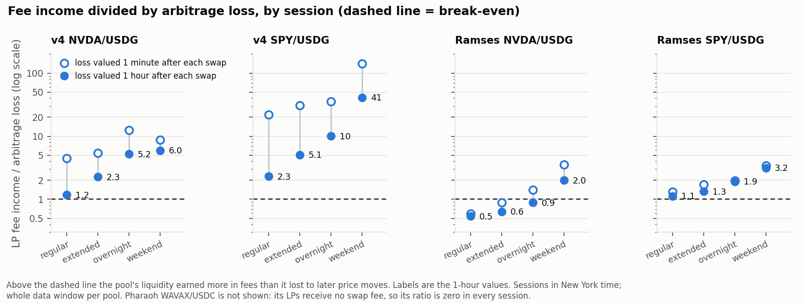

### 4.1 Whole window, all liquidity in the pool

| Pool | Days | Volume a day | Swap fee paid | LP fee income | Loss at +1 min | Loss at +1 h | Fee ÷ loss (+1 min) | Fee ÷ loss (+1 h) |
| --- | --- | --- | --- | --- | --- | --- | --- | --- |
| Uniswap v4 NVDA/USDG | 130 | $400,838 | $172,455 | $156,076 | $26,622 | $81,900 | 5.86 | 1.91 |
| Uniswap v4 SPY/USDG | 119 | $1,000,305 | $415,211 | $355,620 | $10,629 | $76,666 | 33.46 | 4.64 |
| Ramses NVDA/USDG | 98 | $1,736,059 | $24,016 | $15,803 | $15,306 | $19,871 | 1.03 | 0.80 |
| Ramses SPY/USDG | 82 | $3,340,822 | $28,882 | $24,000 | $13,745 | $15,936 | 1.75 | 1.51 |
| Pharaoh WAVAX/USDC | 101 | $22,261,920 | $1,718,851 | $0 | $1,800,003 | $2,003,077 | 0 | 0 |

- **The fee tier and who keeps it decide the sign.** Ramses trades four to eight times the v4 volume in the same
  stocks, but at about 1 bp instead of 30 bp its liquidity collects a tenth of the fees for a comparable loss.
- **Ramses under today's rules is worse than its whole-window figure.** Until 8 October LPs kept 95% of the fee; since
  then 50%. From 9 October the ratio at +1 hour is 0.30 on NVDA and 0.37 on SPY. Applying the 50% share to the whole
  window would give 0.60 and 0.90.
- **Pharaoh:** swappers paid $1.72M, which is 0.86 of the liquidity's loss, and all of it went to the protocol side.
- **The 0.30% pools need the long horizon.** A pool with a 0.35% cost to trade sits up to that far from the market, so
  one minute after a swap its own price has not yet moved; the +1 minute ratios of 5.9 and 33 overstate. The +1 hour
  figures are the ones to use for v4, and section 4.5 shows they keep falling out to 24 hours (1.44 and 1.82).

### 4.2 By session (fee ÷ loss at +1 hour)

| Pool | Regular | Extended | Overnight | Weekend |
| --- | --- | --- | --- | --- |
| Uniswap v4 NVDA/USDG | 1.18 | 2.26 | 5.24 | 5.96 |
| Uniswap v4 SPY/USDG | 2.30 | 5.07 | 10.05 | 41.21 |
| Ramses NVDA/USDG | 0.54 | 0.64 | 0.89 | 2.00 |
| Ramses SPY/USDG | 1.13 | 1.34 | 1.92 | 3.16 |
| Pharaoh WAVAX/USDC | 0 | 0 | 0 | 0 |

Dollars a day, LP fee income / loss at +1 hour:

| Pool | Regular | Extended | Overnight | Weekend |
| --- | --- | --- | --- | --- |
| Uniswap v4 NVDA/USDG | $2,626 / $2,217 | $1,188 / $525 | $1,085 / $207 | $407 / $68 |
| Uniswap v4 SPY/USDG | $5,026 / $2,185 | $2,848 / $562 | $2,218 / $221 | $2,413 / $59 |
| Ramses NVDA/USDG | $237 / $436 | $138 / $215 | $140 / $158 | $152 / $76 |
| Ramses SPY/USDG | $530 / $470 | $270 / $201 | $261 / $136 | $185 / $59 |
| Pharaoh WAVAX/USDC | $0 / $26,363 | $0 / $19,829 | $0 / $18,989 | $0 / $16,076 |

- **Regular hours carry the loss.** They are 19% of the week and 66% of the v4 NVDA loss, 65% of v4 SPY, 41% of Ramses
  NVDA and 46% of Ramses SPY.
- **The weekend is where liquidity is paid best for the risk it takes while there:** the loss per day is 3% to 17% of
  the regular-hours loss while fee income per day is 16% to 64% of it. This is why withdrawing over weekends recovered
  nothing. It says nothing about the gap at Monday's open: that shows up as loss in Monday's extended and regular
  sessions, where it is counted.
- **WAVAX has no session effect in the loss** (25%, 28%, 23%, 24% of the loss across the four clocks), as expected of a
  24-hour asset.

### 4.3 By realised volatility (fee ÷ loss at +1 hour; the quarter's annualised volatility in brackets)

| Pool | Calmest quarter | Second | Third | Most volatile |
| --- | --- | --- | --- | --- |
| Uniswap v4 NVDA/USDG | 8.81 (4%) | 3.73 (10%) | 3.12 (20%) | 1.29 (51%) |
| Uniswap v4 SPY/USDG | 205 (0%) | 20.2 (2%) | 4.14 (4%) | 1.41 (22%) |
| Ramses NVDA/USDG | 3.44 (7%) | 1.14 (13%) | 0.59 (24%) | 0.47 (57%) |
| Ramses SPY/USDG | 3.98 (4%) | 1.84 (7%) | 2.00 (10%) | 0.96 (19%) |
| Pharaoh WAVAX/USDC | 0 (36%) | 0 (50%) | 0 (67%) | 0 (125%) |

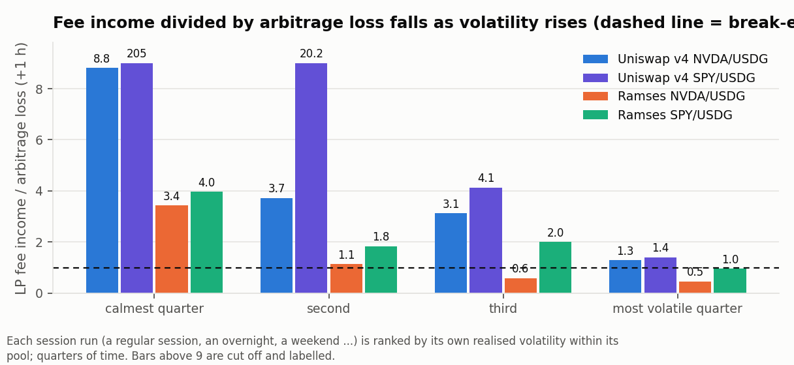

On Ramses NVDA fees cover the loss only in the calmer half of the time (below about 18% annualised). On v4 they cover
it in every quarter, by a margin that shrinks from nearly 9 times to 1.3.

### 4.4 Rolling 30-day windows (one-day step; fee ÷ loss at +1 hour)

| Pool | Windows | Lowest (start) | Highest (start) | Share above 1.0 | Latest (start) |
| --- | --- | --- | --- | --- | --- |
| Uniswap v4 NVDA/USDG | 103 | 0.95 (8 Oct) | 2.62 (4 Sep) | 94% | 0.98 (12 Oct) |
| Uniswap v4 SPY/USDG | 91 | 1.14 (12 Oct) | 33.9 (1 Aug) | 100% | 1.14 (12 Oct) |
| Ramses NVDA/USDG | 70 | 0.28 (8 Oct) | 2.34 (9 Aug) | 41% | 0.29 (12 Oct) |
| Ramses SPY/USDG | 55 | 0.35 (12 Oct) | 3.52 (21 Aug) | 55% | 0.35 (12 Oct) |
| Pharaoh WAVAX/USDC | 73 | 0 | 0 | 0% | 0 |

The lowest window on every stock pool is the most recent one. Two things coincide in it: the highest volatility of the
sample (NVDA fell 14.5% between 19 October and 6 November) and, on Ramses, the cut of the LP share to 50%.

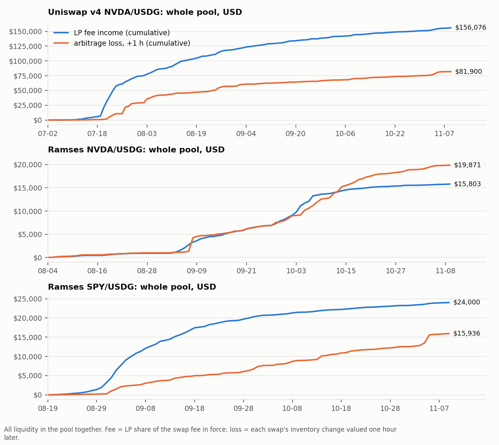

### 4.5 Horizon sensitivity (fee ÷ loss when each swap is valued h later)

| Pool | At the swap | +1 min | +5 min | +1 h | +4 h | +24 h |
| --- | --- | --- | --- | --- | --- | --- |
| Uniswap v4 NVDA/USDG | 10.14 | 5.86 | 3.46 | 1.91 | 1.69 | 1.44 |
| Uniswap v4 SPY/USDG | 86.4 | 33.5 | 17.1 | 4.64 | 2.69 | 1.82 |
| Ramses NVDA/USDG | 1.14 | 1.03 | 0.93 | 0.80 | 0.69 | 0.46 |
| Ramses SPY/USDG | 1.35 | 1.75 | 1.76 | 1.51 | 1.17 | 1.16 |

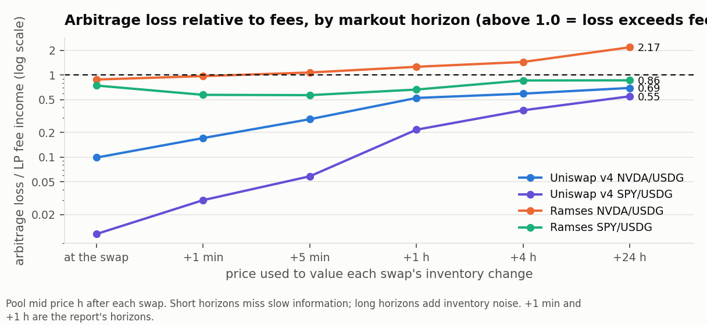

- The verdict for each pool does not change sign between +1 hour and +24 hours, except Ramses NVDA, which is at 1.03
  at one minute and below 1 from five minutes on.
- Past a few hours the measure picks up the drift of whatever inventory the trend left with the liquidity, which a
  delta-matched benchmark carries too. That is why the +1 hour figure is the one used, and why the +24 hour column is a
  bound, not an estimate.

### 4.6 Forecast beside measurement

| Pool | Realised volatility | Mean P_trade | Naive LVR | Fee-adjusted forecast (LVR × P_trade) | Measured loss, +1 min | Measured loss, +1 h | LP fee − loss (+1 h) |
| --- | --- | --- | --- | --- | --- | --- | --- |
| Uniswap v4 NVDA/USDG | 28% | 0.23% | $34,186 | $200 | $26,622 | $81,900 | +$74,177 |
| Uniswap v4 SPY/USDG | 11% | 0.06% | $16,283 | $23 | $10,629 | $76,666 | +$278,954 |
| Ramses NVDA/USDG | 33% | 4.25% | $17,382 | $1,236 | $15,306 | $19,871 | −$4,068 |
| Ramses SPY/USDG | 12% | 3.44% | $15,351 | $694 | $13,745 | $15,936 | +$8,064 |
| Pharaoh WAVAX/USDC | 77% | 10.5% | $2,186,140 | $262,786 | $1,800,003 | $2,003,077 | −$2,003,077 |

- **The naive LVR formula is a good measure of the loss, and a bad forecast of the result.** On the three pools that
  track the market closely it matches the measured loss within about 20% (Ramses NVDA $17.4k against $15.3k to $19.9k;
  Ramses SPY $15.4k against $13.7k to $15.9k; Pharaoh $2.19M against $1.80M to $2.00M).
- **The fee-adjusted figure is one to two orders of magnitude below the measured loss, and that is the finding.** It is
  a statement about a different quantity: what arbitrageurs keep after paying the fee, which on a fast chain is almost
  nothing. The loss itself is still there; the model says the fee hands it back. Whether the LP gets it back depends on
  who receives the fee, which the formula does not contain. A working rule that fits all five rows:
  **LP result against rebalancing ≈ (LP share of the fee) × fees paid − LVR.**
- On v4 the measured +1 hour loss is two to five times the naive figure because volatility computed from a 0.30% pool's
  own sticky price understates the market's, and because an hour of trend is in the measure (section 4.5).

### 4.7 Rewards beside fees and loss (whole pool, full weeks only, valued if sold at that week's price)

| Pool | Weeks | Reward tokens to the gauge | Value if sold | LP fee income | Loss at +1 h | (Reward + fee) ÷ loss | Weeks above 1.0 |
| --- | --- | --- | --- | --- | --- | --- | --- |
| Pharaoh WAVAX/USDC | 13 | 17,235,664 PHAR | $1,072,020 | $0 | $1,923,592 | 0.56 | 1 of 13 |
| Ramses NVDA/USDG | 6 | 222,988 RAM | $8,921 | $9,114 | $12,967 | 1.39 | 4 of 6 |
| Ramses SPY/USDG | 6 | 108,103 RAM | $4,185 | $4,814 | $8,138 | 1.11 | 4 of 6 |

- These are ceilings for the pool as a whole: no sale cost is taken, and the reward token's own pool could not absorb
  the whole emission. Position-level figures with a sale cost are in sections 5 and 7.
- **Pharaoh:** emissions paid for 56% of the liquidity's loss. The fee that would have paid for the other half is paid
  to voters.
- **Ramses:** RAM emissions began in the week of 24 September. Two thirds of the NVDA gauge's RAM came in one week
  (150,000 RAM on 8 October); the gauge now receives about 6,000 RAM a week, worth about $190.
- For a Peridot vault RAM and PHAR are worth nothing to suppliers today: neither vault can sell or distribute them
  (`data/facts/MECHANICS.md` sections 3.4 and 4.5).

### 4.8 Recommendation

| Lever | Decision | Parameters |
| --- | --- | --- |
| Symmetric LP on Pharaoh WAVAX/USDC | **Reject.** Not with this venue's fee split: LPs are paid no swap fee and emissions covered 56% of the loss. | none |
| Symmetric LP on Ramses NVDA/USDG or SPY/USDG as a fee product | **Reject** while the LP share is 50%: fee ÷ loss has been 0.30 and 0.37 since 9 October. | none |
| Symmetric LP on a 0.30% Uniswap v4 pool | **Do not sell as yield; keep as the venue for any pilot.** It is the only venue where fees have covered the loss (94% and 100% of 30-day windows), and the margin is gone in the latest month (0.98 and 1.14). Sections 5 and 9 give the geometry and the session rule. | see sections 5 and 9 |
| Use the naive LVR formula as a risk number | **Adopt** as the loss estimate per unit of liquidity, with volatility taken from a fast pool or the outside market, never from a 0.30% pool's own price. | σ²/4 × L√P |
| Use LVR × P_trade as a forecast of LP loss | **Reject.** It forecasts arbitrageur profit. | none |

### 4.9 Addendum: the Uniswap V3 pools (added after sections 2 to 4 were accepted)

Uniswap V3 is deployed on Robinhood Chain (factory `0x1f7d7550…2efa`, not referenced in our repositories). Its 0.05%
NVDA/USDG pool is where NVDA actually trades: 3.57 million swaps and $1.36 billion of volume since 21 July, seven times
the Ramses pool and thirty times the v4 0.30% pool. The same measurement on the four V3 pools that matter:

| Pool | Days | Volume a day | LP share of fee now | LP fee income | Loss at +1 h | Fee ÷ loss (+1 h) | Regular | Weekend | Latest 30 days | 30-day windows above 1.0 |
| --- | --- | --- | --- | --- | --- | --- | --- | --- | --- | --- |
| Uniswap V3 NVDA/USDG 0.05% (`0xd4eb2120…14a3`) | 112 | $12,131,813 | 75% | $513,108 | $404,415 | 1.27 | 1.04 | 3.30 | 1.03 | 87% |
| Uniswap V3 NVDA/USDG 0.30% (`0xb944cec3…7e2b`) | 121 | $40,459 | 83% | $12,308 | $13,573 | 0.91 | 0.75 | 2.04 | 1.02 | 40% |
| Uniswap V3 SPY/USDG 0.05% (`0xa7bb1ac6…9167`) | 90 | $404,375 | 75% | $13,453 | $8,709 | 1.54 | 1.12 | 3.49 | 0.54 | 77% |
| Uniswap V3 SPY/USDG 0.30% (`0xa43b424b…0ad9`) | 111 | $20,035 | 83% | $5,574 | $1,218 | 4.57 | 1.96 | 16.5 | 0.82 | 93% |

- **The session and volatility pattern is the same on every one of them.** Regular hours carry 51% to 70% of the loss.
- **The naive LVR formula holds again** on the pool that tracks the market: $340,185 forecast against $292,957 (+1 min)
  to $404,415 (+1 h) measured on V3 NVDA 0.05%.
- **NVDA by fee tier**, whole window, fee ÷ loss at +1 hour: Ramses about 1 bp with half to the protocol 0.80; Uniswap V3
  5 bp with three quarters to the LP 1.27; Uniswap V3 30 bp with five sixths to the LP 0.91 (a pool with $40,000 a day);
  Uniswap v4 30 bp with all of it to the LP 1.91. The working rule of section 4.6 fits: what decides the result is the
  fee the LP keeps per dollar of informed flow, and the 5 bp tier is the only one that has both the flow and a ratio
  above 1.
- **LP fee income per day in the last two weeks:** $1,135 on V3 NVDA 0.05%, against $427 on v4 NVDA 0.30%, $31 on
  Ramses NVDA and $71 on Ramses SPY.
- **Correction to section 4.8 as accepted.** Its third row calls the v4 0.30% pool "the only venue where fees have
  covered the loss". With V3 measured that is no longer true: the V3 0.05% NVDA pool has done so too (87% of 30-day
  windows), on thirty times the volume. The row's decision is unchanged; its reason is not exclusive to v4.
- The 0.05% NVDA swap table is 142 MB and is not in the repository; `scripts/pull/rh_05c_univ3_005.py` rebuilds it and
  its checksum is in `data/robinhood/SHA256SUMS`. The position engine has not been run on the V3 pools.

## 5. Question 2: range geometry

**Verdict.** No geometry is positive against holding in every rolling 30-day window on NVDA (Uniswap v4 0.30%, Uniswap
V3 0.05% or Ramses), on Ramses SPY or on WAVAX. On the Uniswap v4 0.30% SPY pool 32 of 39 cells are, and in the latest 30 days they sit between
−0.09% and +0.11%. Across the whole surface the trigger changes little; the half-width decides how large the swings
are in both directions.

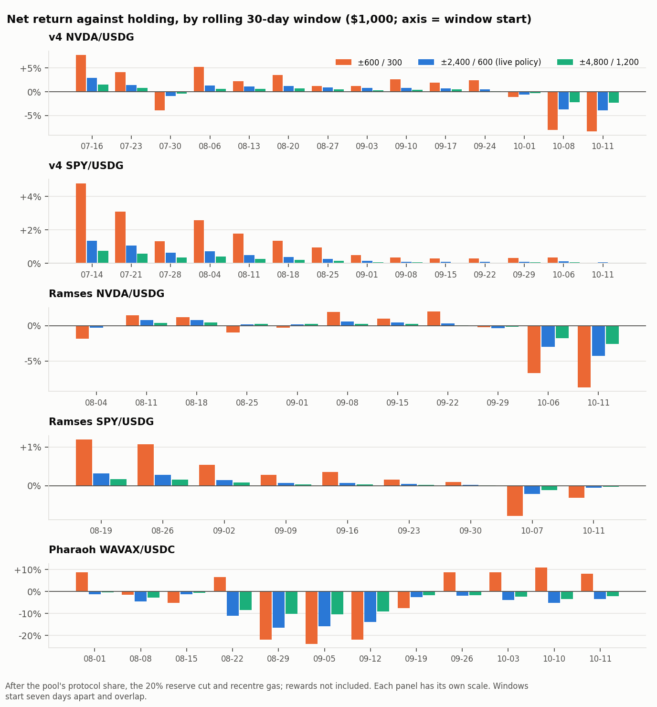

### 5.1 What was swept

- Half-width 600, 900, 1,200, 1,800, 2,400, 3,600, 4,800 ticks; trigger 100, 200, 300, 450, 600, 900, 1,200 ticks.
  The contract rejects a trigger above half the half-width, which leaves 39 of the 49 cells.
- At most 4 recentres per rolling day (the live value), 1 hour cooldown, 10 bp loss bound per recentre, no swap at a
  recentre, keeper every 300 seconds, 20% reserve cut on fees, $1,000 of capital (and $10,000 on the two NVDA pools).
- Windows: each pool's whole history, plus every 30-day window starting seven days apart, plus the latest 30 days.
- The v4 NVDA position runs start on 16 July. In its first two weeks that pool held so little liquidity (about $2,000
  moved the price 1%) that a $1,000 position would have been 1% of it; including them turns +2.5% into +11.9% for the
  live policy and is not representative.
- The sweeps use a 150 bp pool-versus-feed gate before a recentre; the live vault's is 300 bp. It makes no difference
  to the result: the gate blocked no recentre of the ±2,400 / 600 cell on any stock pool (3 on Pharaoh), and 34 and 42
  evaluations in total across all 39 full-window cells on the two NVDA pools.
- The full surfaces, 39 cells per pool, are in `out/tables_q2.md`.

### 5.2 Result by pool ($1,000; net of protocol share, reserve cut and recentre gas; rewards excluded)

| Pool (window) | Full window, range across the 39 cells | Worst 30-day window, range across cells | Windows above holding | Cells positive in the full window and every window | Latest 30 days, range across cells | Fee ÷ LVR, position level |
| --- | --- | --- | --- | --- | --- | --- |
| Uniswap v4 NVDA 0.30% (16 Jul to 10 Nov) | −1.09% to +5.91% | −8.32% to −2.18% | 9 to 11 of 14 | none | −8.32% to −2.18% | 1.77 to 2.76 |
| Uniswap v4 SPY 0.30% (14 Jul to 10 Nov) | +0.88% to +6.93% | −0.09% to +0.11% | 10 to 14 of 14 | 32 (every cell with a trigger of 200 or more) | −0.09% to +0.11% | 6.75 to 7.15 |
| Uniswap V3 NVDA 0.05% (4 Aug to 10 Nov; 9 cells) | +0.90% to +8.63% | −8.43% to −2.18% | 6 to 9 of 11 | none | −8.43% to −2.18% | 1.00 to 1.14 |
| Ramses NVDA (4 Aug to 10 Nov) | −0.94% to +8.05% | −8.83% to −2.46% | 2 to 8 of 11 | none | −8.83% to −2.46% | 0.36 to 0.75 |
| Ramses SPY (19 Aug to 10 Nov) | +0.01% to +1.57% | −0.84% to −0.11% | 3 to 7 of 9 | none | −0.43% to −0.03% | 1.27 to 1.52 |
| Pharaoh WAVAX (1 Aug to 10 Nov) | −14.47% to −0.36% | −24.08% to −10.37% | 0 to 6 of 12 | none | −7.56% to +8.17% | no fee |

Four cells per pool, from narrow to wide:

| Pool | Cell | Full window | Fees | LVR | Recentres | Capital deployed | Worst 30 d | Median 30 d | Best 30 d | Rewards if sold |
| --- | --- | --- | --- | --- | --- | --- | --- | --- | --- | --- |
| v4 NVDA | ±600 / 300 | −1.09% | $69.32 | $25.16 | 41 | 23% | −8.30% | +2.17% | +7.72% | none paid |
| v4 NVDA | ±1,200 / 300 | +1.55% | $85.28 | $41.76 | 41 | 70% | −6.10% | +1.27% | +5.23% | none paid |
| v4 NVDA | ±2,400 / 600 (live policy) | +2.52% | $53.94 | $30.27 | 15 | 86% | −3.86% | +0.81% | +2.90% | none paid |
| v4 NVDA | ±4,800 / 1,200 | +2.48% | $33.45 | $18.47 | 3 | 94% | −2.26% | +0.54% | +1.56% | none paid |
| V3 NVDA 0.05% | ±600 / 300 | +8.63% | $16.06 | $14.03 | 32 | 9% | −8.43% | +0.64% | +2.90% | none paid |
| V3 NVDA 0.05% | ±1,200 / 300 | +6.42% | $35.19 | $35.12 | 32 | 42% | −6.19% | +0.52% | +2.19% | none paid |
| V3 NVDA 0.05% | ±2,400 / 600 | +2.31% | $26.17 | $25.59 | 10 | 70% | −3.83% | +0.40% | +1.44% | none paid |
| V3 NVDA 0.05% | ±4,800 / 1,200 | +1.25% | $16.87 | $15.41 | 3 | 86% | −2.23% | +0.22% | +0.76% | none paid |
| v4 SPY | ±600 / 300 | +6.93% | $66.62 | $9.31 | 6 | 67% | +0.04% | +0.94% | +4.78% | none paid |
| v4 SPY | ±1,200 / 300 | +3.88% | $38.28 | $5.56 | 6 | 81% | +0.06% | +0.50% | +2.57% | none paid |
| v4 SPY | ±2,400 / 600 | +2.16% | $21.71 | $3.20 | 0 | 96% | +0.05% | +0.26% | +1.36% | none paid |
| v4 SPY | ±4,800 / 1,200 | +1.16% | $11.68 | $1.72 | 0 | 98% | +0.03% | +0.14% | +0.73% | none paid |
| Ramses NVDA | ±600 / 300 | +8.05% | $6.00 | $13.21 | 35 | 8% | −8.75% | −0.24% | +2.04% | +0.05% |
| Ramses NVDA | ±1,200 / 300 | +4.78% | $15.96 | $30.62 | 35 | 42% | −6.66% | +0.22% | +1.19% | +0.67% |
| Ramses NVDA | ±2,400 / 600 | +0.97% | $13.27 | $21.28 | 8 | 71% | −4.25% | +0.22% | +0.83% | +0.66% |
| Ramses NVDA | ±4,800 / 1,200 | +0.45% | $9.22 | $12.34 | 3 | 92% | −2.55% | +0.23% | +0.44% | +0.43% |
| Ramses SPY | ±600 / 300 | +1.57% | $16.85 | $12.80 | 1 | 94% | −0.78% | +0.28% | +1.20% | +0.46% |
| Ramses SPY | ±2,400 / 600 | +0.42% | $4.59 | $3.48 | 0 | 99% | −0.21% | +0.07% | +0.32% | +0.13% |
| Pharaoh WAVAX | ±600 / 300 | −0.36% | $0 | $67.32 | 46 | 14% | −23.78% | +6.49% | +10.84% | +3.43% |
| Pharaoh WAVAX | ±2,400 / 600 | −7.79% | $0 | $42.12 | 43 | 32% | −16.45% | −3.92% | −1.18% | +2.71% |
| Pharaoh WAVAX | ±4,800 / 1,200 | −4.03% | $0 | $50.46 | 14 | 55% | −10.45% | −2.38% | −0.49% | +3.34% |

### 5.3 What the surface says

- **The trigger is not a lever.** Along any row of the surface the worst window moves by a few tenths of a point between
  a 100-tick and a 1,200-tick trigger. A tight trigger only multiplies recentres (197 at 100 ticks against 3 to 15 at
  600 to 1,200 on v4 NVDA) and, because nothing is swapped, each recentre leaves more capital idle.
- **Width trades average against worst case, one for one.** On v4 NVDA the median window falls from +2.2% at ±600 to
  +0.5% at ±4,800 while the worst window improves from −8.3% to −2.3%.
- **Narrow ranges are mostly not deployed.** With matched-value-only redeployment a ±600 range on NVDA has 8% to 23% of
  capital in the pool on average. Its large full-window numbers are what the idle inventory did, not what the range
  earned: on Ramses NVDA the +8.05% cell collected $6.00 of fees against $13.21 of LVR.
- **Every pool is decaying in time.** The best windows are the earliest and the worst is the latest on NVDA and on
  Ramses SPY (chart). The latest 30 days hold both the sample's highest volatility and its lowest fee income.
- **Position-level fee ÷ LVR on the 0.30% pools is overstated** (1.8 to 2.8 on v4 NVDA) because the benchmark trades at
  the pool's own slow price. On the V3 0.05% pool, which tracks the market, the same ratio is 1.00 to 1.14. The hedged
  runs in section 7, which have to live with real price moves between hedges, put the v4 position's edge at +1.2% to
  +1.9% of equity from 16 July and at −0.2% to +0.5% from 4 August: fees about equal to the true loss once the July
  weeks are left out.
- **The Uniswap V3 0.05% NVDA pool was run on nine cells** (half-widths 600 to 4,800 with triggers 300, 600 and 1,200),
  from 4 August. It has the best fee-to-loss ratio of any NVDA venue with real flow and it still has no cell that
  survives the latest 30 days.
- **Size.** At $10,000 the v4 NVDA surface differs from the $1,000 one by 0.04 points at the median cell and window and
  1.2 points at most (our share of the pool stays under 3% from 16 July on). On Ramses NVDA fee ÷ LVR falls from 0.36 to 0.75 down to 0.29 to 0.65.
- **Rewards.** With RAM valued if sold, no Ramses NVDA cell becomes positive in every window (4 to 8 of 11). With PHAR
  valued if sold, Pharaoh's best full-window cell is +3.07% and its windows above holding are 1 to 7 of 12.

### 5.4 Operating cost, which is not in the numbers above

The keeper's measured cost on the live vault is $0.14 a day on average and $0.57 a day at the hourly checkpoint cadence
the vault asks for. That is 5% to 21% a year of a $1,000 pair and 0.5% to 2.1% of a $10,000 one. At the live caps ($1,000
pair, $50 ranged) no geometry on any pool pays for its keeper.

### 5.5 Recommendation

| Lever | Decision | Parameters |
| --- | --- | --- |
| Re-open symmetric LP on NVDA/USDG on any of the three venues, any geometry | **Reject.** No cell survives the latest 30 days (−2.2% to −8.8%), including on Uniswap V3 0.05%. | none |
| Symmetric LP on WAVAX/USDC (Pharaoh) | **Reject.** No swap fee; negative in the full window in every cell. | none |
| Symmetric LP on SPY/USDG, Uniswap v4 0.30% | **Test live at pilot size, and only if a SPY market is opened** (none exists on the live controller). It is the one pool with cells positive in every window, at a margin that has shrunk to about zero; at $1,000 it cannot cover $51 a year of keeper cost. | half-width 1,200, trigger 300, max 4 a day, cooldown 3,600 s, loss bound 10 bp; stop if two consecutive 30-day windows end below holding |
| Tight triggers | **Reject.** No benefit anywhere on the surface. | keep trigger at half the half-width or 600, whichever is smaller |
| A policy change must move the range | **Adopt.** A stored policy did not move the live range for 14 days and cost about 1.1 points (section 3, item 1). | after `RangePolicyUpdated`, send `recenter` once the cooldown allows, whether or not the trigger is met; alarm if the range in the pool is not the policy's width |

## 6. Question 3: one-sided bands

**Verdict.** On the venues the product targets the fee is decorative: nothing on Pharaoh, 10 to 19 bp per $1,000 order on
Ramses NVDA. The real difference from a limit order is that a band is not final until it is fully crossed and closed.
In 6% to 16% of seven-day orders on NVDA and WAVAX a limit at the band's average price would have filled and the band did
not. Valued when the order expired, those orders were 2% to 9% of the order behind after seven days and 1% to 4% behind
after two; the frequency is the robust number, the size depends on how long the user is left holding. On SPY the shipped
presets filled in 0 of 302 seven-day orders.

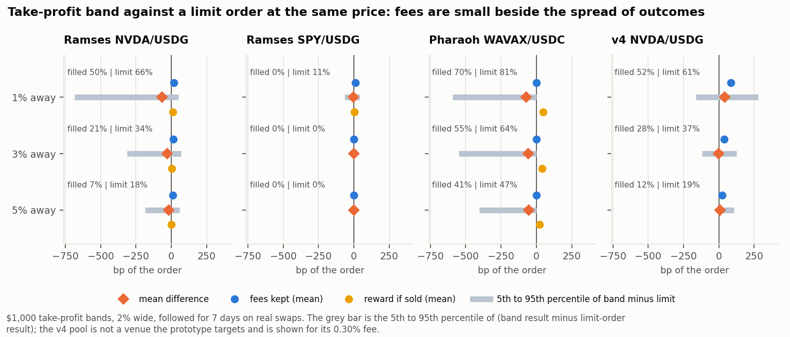

### 6.1 What was modelled

- The prototype's presets: a band 100, 300 or 490 ticks (1%, 3%, 5%) from the pool price, 200 ticks (2%) wide.
- One order every six hours through each pool's history, followed for seven days on the real swap path; $1,000 per
  order. Sensitivities: $10,000, a 100-tick width, a two-day life.
- **Finalize as the contract does it:** the keeper polls every 30 seconds (20 on Avalanche) and closes the band the
  first time it sees the pool beyond the far edge, the feed no older than 12 hours and the pool within 1% of the feed.
  Until then the band stays in the pool and converts back if the price returns.
- **Fees:** the LP share of each swap that ran inside the band, diluted by the pool's liquidity; the user keeps 70% on
  Robinhood (the decided split) and all of it on Pharaoh, where it is zero.
- **Benchmark:** a limit order for the same amount at the band's average fill price, no fee, final when touched. Both
  are valued at the end of the seven days.
- The buy band below the market is not built; it is modelled as the mirror image.

### 6.2 Take-profit bands, $1,000, seven days

| Pool | Distance | Band filled and closed | Limit filled | Limit filled, band not | Fees kept (mean) | Fees kept when filled | Reward if sold (mean) | Band − limit, mean | Median | 5th percentile | 95th percentile |
| --- | --- | --- | --- | --- | --- | --- | --- | --- | --- | --- | --- |
| Ramses NVDA | 1% | 50% | 66% | 16% | 18.8 bp | 26.6 bp | 9.9 bp | −64 bp | +4 bp | −683 bp | +51 bp |
| Ramses NVDA | 3% | 21% | 34% | 13% | 15.0 bp | 41.9 bp | 5.1 bp | −30 bp | 0 | −313 bp | +68 bp |
| Ramses NVDA | 5% | 7% | 18% | 11% | 10.2 bp | 38.9 bp | 1.0 bp | −18 bp | 0 | −186 bp | +56 bp |
| Ramses SPY | 1% | 0% | 11% | 11% | 10.7 bp | none filled | 2.5 bp | −4 bp | 0 | −67 bp | +40 bp |
| Ramses SPY | 3% | 0% | 0% | 0% | 0 | none filled | 0 | 0 | 0 | 0 | 0 |
| Ramses SPY | 5% | 0% | 0% | 0% | 0 | none filled | 0 | 0 | 0 | 0 | 0 |
| Pharaoh WAVAX | 1% | 70% | 81% | 11% | 0 | 0 | 48.6 bp | −72 bp | 0 | −593 bp | 0 |
| Pharaoh WAVAX | 3% | 55% | 64% | 9% | 0 | 0 | 41.9 bp | −58 bp | 0 | −548 bp | 0 |
| Pharaoh WAVAX | 5% | 41% | 47% | 6% | 0 | 0 | 23.5 bp | −52 bp | 0 | −404 bp | 0 |
| Uniswap v4 NVDA 0.30% (not a target venue) | 1% | 52% | 61% | 9% | 85.7 bp | 133.9 bp | none paid | +42 bp | +35 bp | −163 bp | +276 bp |
| Uniswap v4 NVDA 0.30% (not a target venue) | 3% | 28% | 37% | 9% | 38.5 bp | 80.4 bp | none paid | −4 bp | 0 | −120 bp | +126 bp |
| Uniswap v4 NVDA 0.30% (not a target venue) | 5% | 12% | 19% | 7% | 22.2 bp | 67.3 bp | none paid | +7 bp | 0 | 0 | +107 bp |

Buy bands give the same picture (`out/tables_q3.md`): on Ramses NVDA 55%, 35% and 19% filled at 1%, 3% and 5%, fees of
17, 12 and 11 bp, and 9% to 13% of orders where only the limit filled.

### 6.3 What it says

- **Are the fees material or decorative?**
  - **Pharaoh:** there are none. The contract returns exactly the principal. A user-facing line that says the band
    "earns fees while it waits" is false on WAVAX/USDC.
  - **Ramses:** decorative. A filled NVDA band keeps 27 to 42 bp after the pool's 50% and the 70 / 20 / 10 split;
    averaged over all orders, 10 to 19 bp. One order in twenty ends 2% to 7% behind the limit order.
  - **A 0.30% Uniswap pool:** material. A filled band keeps 67 to 134 bp and the 1% band beats the limit in 70% of
    orders. The prototype does not target this venue.
- **The cost of not being final.** When the limit would have filled and the band did not, the band holder still has
  the stock after it turned back. How much that costs depends on when it is valued. At the end of a seven-day order:
  −490, −312 and −189 bp on Ramses NVDA (1%, 3%, 5% away) and −635, −668 and −860 bp on Pharaoh. At the end of a
  two-day order: −134 to −257 bp and −330 to −393 bp, with the limit-only share at 19%, 3% and 2% on Ramses NVDA and 13%,
  9% and 7% on Pharaoh. The share of orders is the stable figure.
  It is a property of the 2% width, not of the keeper: finalize was blocked by the feed conditions in only 0.3% to
  3% of orders on NVDA and WAVAX.
- **Rewards are the only income on Pharaoh:** 23 to 49 bp of PHAR per order if sold (about 107 PHAR on a 1% band),
  which goes whole to the order owner in the prototype. On Ramses NVDA, 1 to 10 bp of RAM.
- **Width.** Halving the width to 100 ticks on WAVAX cuts "limit filled, band not" from 11% to 5% at 1% away and the
  5th percentile from −593 bp to −41 bp, while PHAR per order falls from 49 to 30 bp. On Ramses NVDA the same change
  does little (16% to 14%).
- **SPY needs its own presets.** SPY moved 3% in a week too rarely for a band that starts 1% away and is 2% wide. With
  presets scaled to its volatility (30, 60 and 100 ticks away, 50 wide) 48%, 40% and 24% of take-profit bands fill,
  fees kept are 38, 31 and 21 bp, and the mean difference from the limit is +22, +14 and −3 bp. But on SPY 10% to 24% of
  those orders were beyond the far edge at a moment the feed conditions refused the close: the SPY feed updates about
  twice a day.
- **Size and life.** At $10,000 fees kept per order fall by a third to a half (12, 9 and 5 bp on Ramses NVDA). A two-day
  life fills 18%, 4% and 2% of Ramses NVDA bands.

### 6.4 Recommendation

| Lever | Decision | Parameters |
| --- | --- | --- |
| Describe the band as an order type, not as a way to earn | **Adopt.** Zero fee on Pharaoh, decorative on Ramses. | product copy: no fee or yield claim on WAVAX/USDC; on Ramses state "fees, if any, are small" |
| Show the non-finality in the product | **Adopt.** | before placement: "this order completes only if the price passes the far edge and is seen there; if it turns back, your tokens are converted back" |
| Narrower band on WAVAX | **Test live at pilot size.** | presets 1 to 3: distance 100 / 300 / 490 ticks, width 100 (now 200) |
| Keep 200 ticks on NVDA | **Adopt** (no gain from 100). | distance 100 / 300 / 490, width 200 |
| SPY presets | **Reject the shipped presets for SPY; test the scaled ones at pilot size.** | distance 30 / 60 / 100 ticks, width 50; the feed conditions refused the close at first sight in a quarter of orders at the nearest preset, so the SPY feed's update rate has to be dealt with first |
| Count PHAR as the user's | **Adopt** as built (whole to the owner), shown in tokens, not as a rate. | none |

## 7. Question 4: hedged mode at scale

**Verdict.** Hedged LP is not positive after costs at $1,000 or at $10,000, on any of the five venue and route
combinations tested, with or without rewards, and it cannot be opened today. On the route that exists (Uniswap v4 NVDA,
short through the margin market) it earns +1.2% to +1.9% of equity before hedge costs over 117 days and −1.4% to −3.1%
after them; it is above zero in at most 1 of 13 rolling 30-day windows. Routing the hedge through the Uniswap V3 0.05%
pool cuts swap costs to a quarter and still ends at −1.3% to −2.5% over 98 days.

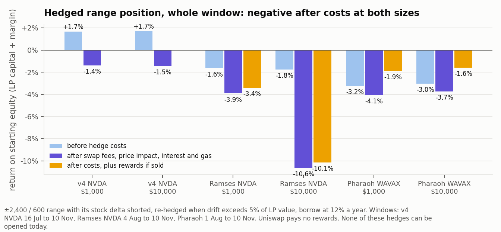

### 7.1 What was modelled

- **LP leg:** the ±2,400 / 600 range of section 5, on real swaps.
- **Hedge ratio:** the pair's actual stock holding at each 300-second sample (ranged position, idle inventory and
  accrued fees), not a fixed multiple. The short is re-set when it drifts more than 2%, 5% or 10% of LP value.
- **Costs per adjustment:** the swap fee in force on the hedge venue (0.35% on v4 as the executor pays it, the dynamic
  fee on Ramses and Pharaoh), 5 bp to the flash vault on Robinhood, price impact against that pool's active liquidity at
  that moment, and gas ($0.10 Robinhood, $0.05 Avalanche).
- **Contract conditions:** no adjustment while the feed is older than 12 hours or the pool is more than 1% from it, as
  the margin stack requires. Margin posted is half the opening short.
- **Funding:** stock borrowed at 12% a year, the rate model's value at its 80% kink. Today's 2.0% applies only to a
  borrow that leaves utilisation near zero; any real hedge needs new supply, and the least supply that keeps the rate at
  12% is 1.25 times the short. Collateral earns the 0.18% USDG supply rate.
- Start equity is LP capital plus margin. Benchmarks hold the same cash beside the deposited tokens.

### 7.2 Whole window

| Pool and hedge route | Size | Rebalance at | Hedged | Unhedged LP | Hold | Hedged before hedge costs | Swap fees | Price impact | Interest | Gas | Adjustments | Rewards if sold | Hedged + rewards |
| --- | --- | --- | --- | --- | --- | --- | --- | --- | --- | --- | --- | --- | --- |
| v4 NVDA, hedge on v4 (16 Jul to 10 Nov) | $1,000 | 2% | −3.09% | −3.51% | −5.53% | +1.94% | 1.81% | 0.04% | 1.65% | 1.54% | 192 | none paid | −3.09% |
| | $1,000 | 5% | −1.38% | −3.51% | −5.53% | +1.67% | 1.04% | 0.04% | 1.65% | 0.32% | 40 | none paid | −1.38% |
| | $1,000 | 10% | −1.39% | −3.51% | −5.53% | +1.22% | 0.81% | 0.04% | 1.64% | 0.12% | 15 | none paid | −1.39% |
| | $10,000 | 2% | −2.06% | −3.47% | −5.53% | +1.99% | 1.81% | 0.44% | 1.64% | 0.15% | 192 | none paid | −2.06% |
| | $10,000 | 5% | −1.46% | −3.47% | −5.53% | +1.70% | 1.04% | 0.44% | 1.65% | 0.03% | 40 | none paid | −1.46% |
| | $10,000 | 10% | −1.64% | −3.47% | −5.53% | +1.26% | 0.81% | 0.44% | 1.64% | 0.01% | 15 | none paid | −1.64% |
| Ramses NVDA, hedge on Ramses (4 Aug to 10 Nov) | $1,000 | 5% | −3.92% | −4.32% | −5.10% | −1.64% | 0.24% | 0.76% | 0.96% | 0.31% | 39 | +0.53% | −3.40% |
| | $1,000 | 10% | −2.96% | −4.32% | −5.10% | −1.09% | 0.14% | 0.68% | 0.97% | 0.08% | 10 | +0.53% | −2.43% |
| | $10,000 | 5% | −10.64% | −4.42% | −5.10% | −1.76% | 0.24% | 7.64% | 0.97% | 0.03% | 39 | +0.51% | −10.13% |
| | $10,000 | 10% | −9.12% | −4.42% | −5.10% | −1.21% | 0.14% | 6.79% | 0.97% | 0.01% | 10 | +0.51% | −8.61% |
| v4 NVDA, hedge on v4, same window as the two rows below (4 Aug to 10 Nov) | $1,000 | 5% | −1.95% | −2.68% | −4.67% | +0.12% | 0.87% | 0.02% | 0.95% | 0.23% | 29 | none paid | −1.95% |
| v4 NVDA, hedge routed through Uniswap V3 0.05% (4 Aug to 10 Nov; route not built) | $1,000 | 5% | −1.65% | −2.68% | −4.67% | −0.24% | 0.22% | 0.01% | 0.95% | 0.23% | 29 | none paid | −1.65% |
| | $10,000 | 5% | −1.48% | −2.65% | −4.67% | −0.21% | 0.22% | 0.08% | 0.95% | 0.02% | 29 | none paid | −1.48% |
| Uniswap V3 NVDA 0.05%, hedge on the same pool (4 Aug to 10 Nov; neither leg built) | $1,000 | 5% | −1.69% | −2.91% | −4.75% | −0.21% | 0.23% | 0.01% | 0.96% | 0.28% | 35 | none paid | −1.69% |
| | $10,000 | 5% | −1.47% | −2.87% | −4.75% | −0.17% | 0.23% | 0.08% | 0.96% | 0.03% | 35 | none paid | −1.47% |
| Pharaoh WAVAX, hedge on Pharaoh (1 Aug to 10 Nov; not available) | $1,000 | 5% | −4.05% | +6.38% | +12.61% | −3.24% | 0.22% | 0.00% | 0.46% | 0.13% | 33 | +2.17% | −1.89% |
| | $10,000 | 5% | −3.74% | +6.58% | +12.61% | −3.03% | 0.22% | 0.02% | 0.46% | 0.01% | 33 | +2.16% | −1.58% |

Percentages are of starting equity. Every size and threshold of every run is in `out/tables_q456.md`.

### 7.3 Rolling 30-day windows

| Pool | Size | Rebalance at | Worst | Median | Best | Windows above zero | With rewards if sold: windows above zero |
| --- | --- | --- | --- | --- | --- | --- | --- |
| v4 NVDA | $1,000 | 5% | −1.12% | −0.76% | +0.44% | 1 of 13 | none paid |
| v4 NVDA | $10,000 | 5% | −1.25% | −0.72% | +0.37% | 1 of 13 | none paid |
| v4 NVDA, hedge through V3 0.05% | $1,000 | 5% | −1.05% | −0.52% | −0.28% | 0 of 10 | none paid |
| V3 NVDA 0.05%, hedge on the same pool | $1,000 | 5% | −1.03% | −0.68% | −0.17% | 0 of 10 | none paid |
| Ramses NVDA | $1,000 | 5% | −4.20% | −1.02% | −0.75% | 0 of 10 | 0 of 10 |
| Ramses NVDA | $10,000 | 5% | −20.71% | −2.22% | −0.69% | 0 of 10 | 0 of 10 |
| Pharaoh WAVAX | $1,000 | 5% | −4.92% | −2.66% | −1.59% | 0 of 11 | 0 of 11 |
| Pharaoh WAVAX | $10,000 | 5% | −4.67% | −2.53% | −1.50% | 0 of 11 | 0 of 11 |

### 7.4 What it says

- **Hedging removes the direction and leaves fee minus loss.** That remainder is positive only on v4 from 16 July
  (+1.2% to +1.9% over 117 days), and most of it was earned in the July weeks: from 4 August it is +0.1% to +0.5% when
  the hedge trades on v4 and −0.1% to −0.2% when it trades on V3 0.05%, where prices are current. It is −0.2% to 0.0% for
  a V3 0.05% position, −1.1% to −1.6% on Ramses NVDA and −3% on Pharaoh. This is section 4 again at position level.
- **The cheaper route does not rescue it.** Through V3 0.05% the swap cost of the hedge falls from 0.87% of equity to
  0.22% over 98 days, and the result is still −1.5% to −1.7% because borrow interest at 12% (0.95%) is now the largest
  line. With the borrow at today's 2.0% it would be about −0.9% to −0.7%.
- **On v4 the costs are larger than the edge.** At the 5% threshold: 1.04% of swap fees (0.40% per adjustment including
  the flash vault), 1.65% of borrow interest and 0.32% of gas against 1.67%. With the borrow at today's 2.0% instead of
  12% the result would be between −0.3% and 0.0% over the 117 days: break-even at best.
- **Threshold.** No threshold changes the sign. 5% or 10% is the least bad on v4 and Ramses; 2% quadruples the trades.
  The spread between thresholds (0.6 to 1.7 points) is smaller than the costs.
- **Size is capped by depth, not by caps alone.** On Ramses NVDA price impact goes from 0.76% of equity at $1,000 to
  7.6% at $10,000: that pool's liquidity fell to about $2,200 per 1% in late October. On v4 it goes from 0.04% to 0.44%.
- **Rewards do not rescue it either.** RAM if sold adds 0.5% on Ramses NVDA; PHAR if sold adds 2.2% on Pharaoh. Neither turns a
  single 30-day window positive.
- **It cannot be opened.** Robinhood: per-position caps of $2 of position and $1 of debt, 0.032 NVDA lendable, 0.025
  NVDA in the flash vault, no SPY market. Avalanche: WAVAX borrowing is paused and no short pair exists. The margin
  price also goes to zero whenever the NVDA feed is older than 12 hours, which is every weekend.
- The 6 November figure (−0.55% over 17.75 days at $1,000) holds up: this run's −0.76% median per 30 days at the same
  threshold is the same magnitude, with the flash fee and the real 0.35% pool cost now included.

### 7.5 Recommendation

| Lever | Decision | Parameters |
| --- | --- | --- |
| Hedged LP as a D order | **Reject** on every venue and route tested (v4, V3 0.05%, Ramses, Pharaoh) and at both sizes. | none |
| Raising margin caps for a hedged pilot | **Reject.** The caps are not what stops it; the economics are. | leave `maxPositionValueUsd` $2 and `maxDebtValueUsd` $1 |
| If it is revisited | Only when a pool's hedged result before costs exceeds borrow interest plus about 0.3% of swap cost per quarter. No NVDA pool has met that since 4 August. | threshold 5% to 10% of LP value; margin half the short; hedge routed through the lowest-fee deep pool |

## 8. Question 5: reward timing

**Verdict.** There is no realised loss to report: no Peridot position has earned RAM on mainnet, and the two Pharaoh
vaults' PHAR (2.5 and 0.9 PHAR) has never been claimed. Applying the gauge's rule to the simulated position, the three
policies are indistinguishable at pilot activity (0% to 0.02% of rewards lost). A visible loss needs frequent liquidity
changes and dense claims together: up to 2.75% (Ramses) or 3.1% (Pharaoh) with an hourly rebalance, and more only if
users force unwinds a hundred times a day.

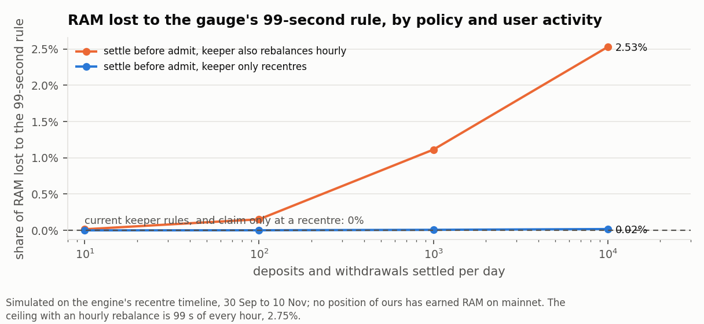

### 8.1 The rule, as fork-measured and read on chain

- A claim made within the threshold after the position's last liquidity change pays nothing, and what accrued since
  that change is gone (to the Ramses treasury, or to r33 on Pharaoh). A later claim pays in full.
- The threshold is `voter.timeThresholdForGauge`: 99 seconds on both Ramses gauges, 111 seconds on the Pharaoh gauges.
- Every liquidity change claims. So the only reward at risk is what accrues in the first 99 (or 111) seconds after a
  liquidity change, and only if something claims inside that time.
- Pharaoh's documents describe a harsher scope ("everything since the last successful claim"). Because each liquidity
  change claims, the backlog at risk is still only what accrued since the previous change; the two readings give the
  same number unless claims fail repeatedly.

### 8.2 What the position would have earned (±2,400 / 600; rewards valued if sold, less a 3% sale cost on RAM and 2% on PHAR)

| Gauge | Window | Position | Reward accrued | Value if sold | Share of capital | LP fees | LVR |
| --- | --- | --- | --- | --- | --- | --- | --- |
| Ramses NVDA | 30 Sep to 10 Nov | $1,000 | 177 RAM | $7.58 | 0.76% | $3.03 | $9.47 |
| Ramses NVDA | 30 Sep to 10 Nov | $10,000 | 1,726 RAM | $74.16 | 0.74% | $29.52 | $94.68 |
| Ramses SPY | 30 Sep to 10 Nov | $1,000 | 38 RAM | $1.33 | 0.13% | $0.84 | $1.87 |
| Ramses SPY | 30 Sep to 10 Nov | $10,000 | 378 RAM | $13.25 | 0.13% | $8.39 | $18.66 |
| Pharaoh WAVAX | 1 Aug to 10 Nov | $1,000 | 902 PHAR | $27.06 | 2.71% | $0 | $37.11 |
| Pharaoh WAVAX | 1 Aug to 10 Nov | $10,000 | 8,985 PHAR | $269.43 | 2.69% | $0 | $371.11 |

On Ramses NVDA since emissions began, RAM if sold plus fees ($10.61) exceeded the position's LVR ($9.47); two thirds of
that RAM came in one week. A Peridot vault cannot sell or distribute RAM or PHAR today, so to suppliers these amounts
are worth nothing until a mechanism exists.

### 8.3 Share of rewards lost, by policy (Ramses NVDA gauge; the SPY gauge is within 0.01 point of it)

The policies and the two activity inputs, as modelled here (the brief names the policies; these definitions are mine):

- **Current rules:** the keeper sends no harvest, recentre or rebalance within 120 seconds of the position's last
  liquidity change, and harvests every 6 hours (`ramses_keeper.py`).
- **Claim only at a recentre:** no separate harvest; rewards are claimed only by the recentre's own liquidity change.
- **Settle before admit:** current rules, plus one claim immediately before every deposit or withdrawal is admitted, so
  that a new share never dilutes rewards already earned. A settlement is a claim with no liquidity change.
- **User-driven unwind:** a withdrawal or liquidation that removes liquidity from the position at a time the keeper
  does not choose. It is a liquidity change, so it claims and restarts the 99-second clock.
- **Hourly rebalance:** the keeper redeploys idle inventory every hour (a liquidity change), as the v4 keeper did before
  its value gate.

| Policy | Keeper also rebalances hourly | User-driven unwinds a day | Settlements a day | Reward lost |
| --- | --- | --- | --- | --- |
| Current rules (no keeper action within 120 s of a change; harvest every 6 h) | no | 0 | n/a | 0% |
| Current rules | no | 10 | n/a | 0.007% |
| Current rules | no | 100 | n/a | 0.61% |
| Current rules | yes | 10 | n/a | 0.023% |
| Claim only at a recentre | no | 0 | n/a | 0% |
| Claim only at a recentre | no | 10 | n/a | 0.006% |
| Claim only at a recentre | no | 100 | n/a | 0.60% |
| Settle before admit | no | 0 | 10 | 0.000% |
| Settle before admit | no | 0 | 1,000 | 0.008% |
| Settle before admit | no | 0 | 10,000 | 0.018% |
| Settle before admit | yes | 0 | 100 | 0.15% |
| Settle before admit | yes | 0 | 1,000 | 1.11% |
| Settle before admit | yes | 0 | 10,000 | 2.53% |
| Settle before admit | no | 10 | 1,000 | 0.48% |
| Settle before admit | no | 100 | 10,000 | 9.94% |
| No spacing at all (a rebalance 5 s after each recentre) | yes | 0 | n/a | 0.001% |

- **Current rules against claim-only-before-recentre:** the same. Under this gauge rule a separate harvest neither
  loses nor saves anything; the only difference is how long RAM sits unclaimed in the gauge.
- **Settle-before-admit** is safe as long as the keeper rarely changes liquidity. Its loss is the number of liquidity
  changes a day times 99 seconds, times the chance that a settlement lands inside each: with only recentres (6 in 41
  days) it is nil at any activity; with an hourly rebalance and thousands of settlements a day it approaches the
  ceiling of 99 / 3,600 = 2.75%.
- **User-driven unwinds** are the one thing the keeper cannot space. At 100 a day they cost 0.6% on their own (0.8% on
  Pharaoh), and combined with settle-before-admit at 10,000 settlements a day, 10% on Ramses and 11% on Pharaoh: every unwind
  opens a 99 or 111-second window and a settlement is almost certain to land in it. The ceiling in general is the number of
  liquidity changes a day times the threshold, divided by 86,400 seconds.
- **In dollars** these are cents: 2.5% of the $7.58 a $1,000 position accrued on the NVDA gauge is $0.19.
- **Bands.** A take-profit band has its own position; a close within 99 or 111 seconds of placement forfeits that
  window's reward. The median time to a fill is 22 to 118 hours, so this does not arise in practice.
- The treasury slice measured on the fork (2.1% to 2.3%) was a rebalance five seconds after a recentre with a claim 200
  seconds later: 5 seconds of a 205-second accrual. Over a real holding period the same five seconds are 0.001%.

### 8.4 Recommendation

| Lever | Decision | Parameters |
| --- | --- | --- |
| Keeper spacing | **Adopt** as built. | `ANTI_SYBIL_WAIT` 120 s on Ramses; the same wait on Pharaoh must be at least 112 s |
| Claim only before a recentre | **Reject** as a change: no saving. | none |
| Settle before admit | **Adopt**, with one guard. | settle only if at least 100 s (Ramses) or 112 s (Pharaoh) have passed since the position's last liquidity change; otherwise queue the admit to the next keeper tick |
| Hourly rebalance of a staked-reward position | **Reject.** It is what creates the exposure. | rebalance only behind the value gate (10 times gas), as the Ramses keeper already does |
| A sale or distribution mechanism for RAM and PHAR | Not a timing question; until one exists the reward line is zero for suppliers. | none |

## 9. Question 6: session-aware allocation

**Verdict.** Holding a wider range over the weekend does not beat fixed width: it finished ahead of the better of the two
fixed ranges in 0 of 14 rolling windows on v4 NVDA, 0 of 11 on Ramses NVDA and 0 of 9 on Ramses SPY. The reverse plan
(narrow over the weekend) is ahead in 5 of 14, 5 of 11 and 1 of 9, which does not establish anything. Fixed width stands.

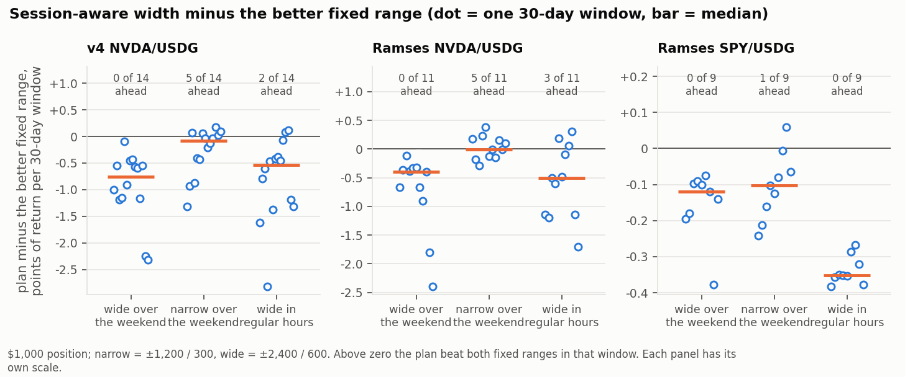

### 9.1 What was tested

- Narrow and wide pairs: ±600/300 with ±2,400/600; ±1,200/300 with ±2,400/600; ±1,200/300 with ±4,800/1,200;
  ±2,400/600 with ±4,800/1,200.
- **Wide over the weekend:** wide from 30 minutes before Friday's close to 30 minutes after Monday's open, narrow
  otherwise. **Narrow over the weekend:** the reverse. **Wide in regular hours:** wide from 09:30 to 16:00 New York,
  narrow otherwise.
- A switch is an ordinary recentre: it costs gas, waits for the cooldown and the feed, and redeploys matched value only.
- Each plan is compared, window by window, with both fixed ranges it is built from.

### 9.2 Result (narrow ±1,200 / 300, wide ±2,400 / 600; $1,000)

| Pool | Plan | Full window | Fees | LVR | Recentres (of which switches) | Worst 30 d | Median 30 d | Windows ahead of both fixed ranges |
| --- | --- | --- | --- | --- | --- | --- | --- | --- |
| v4 NVDA | fixed narrow | +1.55% | $85.28 | $41.76 | 41 | −6.10% | +1.25% | |
| v4 NVDA | fixed wide | +2.52% | $53.94 | $30.27 | 15 | −3.86% | +0.80% | |
| v4 NVDA | wide over the weekend | +3.39% | $76.34 | $44.80 | 63 (34) | −6.17% | +0.71% | 0 of 14 |
| v4 NVDA | narrow over the weekend | +3.97% | $68.27 | $34.27 | 49 (34) | −3.76% | +1.11% | 5 of 14 |
| v4 NVDA | wide in regular hours | +9.99% | $63.68 | $30.76 | 172 (164) | −5.17% | +0.82% | 2 of 14 |
| Ramses NVDA | fixed narrow | +4.78% | $15.96 | $30.62 | 35 | −6.66% | +0.22% | |
| Ramses NVDA | fixed wide | +0.97% | $13.27 | $21.28 | 8 | −4.25% | +0.22% | |
| Ramses NVDA | wide over the weekend | +1.42% | $14.49 | $27.98 | 53 (28) | −6.65% | −0.21% | 0 of 11 |
| Ramses NVDA | narrow over the weekend | +4.15% | $15.24 | $24.94 | 40 (28) | −4.15% | +0.48% | 5 of 11 |
| Ramses NVDA | wide in regular hours | +5.89% | $8.83 | $16.84 | 145 (138) | −5.96% | −0.03% | 3 of 11 |
| Ramses SPY | fixed narrow | +0.80% | $8.75 | $6.70 | 1 | −0.41% | +0.14% | |
| Ramses SPY | fixed wide | +0.42% | $4.59 | $3.48 | 0 | −0.21% | +0.07% | |
| Ramses SPY | wide over the weekend | +0.47% | $6.96 | $5.51 | 25 (24) | −0.59% | +0.05% | 0 of 9 |
| Ramses SPY | narrow over the weekend | +0.40% | $6.01 | $4.09 | 24 (24) | −0.15% | +0.04% | 1 of 9 |
| Ramses SPY | wide in regular hours | −0.19% | $7.37 | $5.28 | 114 (114) | −0.53% | −0.20% | 0 of 9 |

The other three pairs are in `out/tables_q456.md`; wide over the weekend is ahead in 0 or 1 window in every one of them.

### 9.3 What it says

- **Wide over the weekend loses on both counts.** It is narrow exactly when the loss is highest (regular hours) and wide
  exactly when fee income per unit of loss is highest (the weekend, section 4.2), and it pays for two extra recentres a
  week that each idle some capital.
- **Narrow over the weekend** has the direction section 4 suggests, and its worst window is close to the wide range's
  (−3.76% against −3.86% on v4 NVDA). But it is ahead of both fixed ranges in fewer than half the windows, the windows
  overlap, and part of its apparent gain is that 34 extra recentres redeploy idle capital, which a fixed range could do
  too. It also carries a narrow range through Monday's open.
- **Wide in regular hours** needs about 1.4 switches a day against a cap of 4 and is ahead in 0 to 4 windows.
- **WAVAX** has no sessions (section 4.2), so there is nothing for such a plan to act on; its runs differ from fixed
  width only by noise.
- Together with the earlier counterfactual (withdrawing over weekends recovered nothing), the weekend is not where the
  loss is. No session rule on width is supported.

### 9.4 Recommendation

| Lever | Decision | Parameters |
| --- | --- | --- |
| Wider ranges over the weekend | **Reject.** | none |
| Narrower ranges over the weekend | **Reject for now;** not established on this sample. If it is ever tested: | ±1,200 / 300 from Friday 15:30 to Monday 10:00 New York, ±2,400 / 600 otherwise; judged against fixed ±2,400 / 600 over at least eight non-overlapping weeks |
| Wider ranges in regular hours | **Reject.** | none |
| Keeper weekend rule (`WEEKEND_RULE`, off by default) | **Keep off.** | none |

## 10. Question 7: Blackhole WAVAX/USDC against Pharaoh

**Verdict.** Blackhole pays its liquidity providers no swap fee either: every fee leaves the pool, 98% to voters and 2% to
Algebra. What differs is the emission: over 13 full weeks BLACK emissions were worth 1.14 times the pool's arbitrage
loss (above it in 9 weeks), against 0.56 for PHAR on Pharaoh (above it in 1). Blackhole's pool is a fifteenth as deep at
1% and a twenty-fifth at 10%, a position held the way our vaults hold one (not staked) earns nothing at all there, and
no staked range beat holding in every 30-day window.

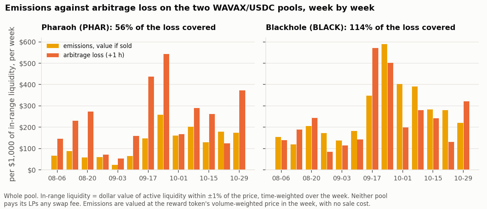

### 10.1 The pool

| | Blackhole | Pharaoh |
| --- | --- | --- |
| Pool | `0x41100C6D2c6920B10d12Cd8D59c8A9AA2eF56fC7`, Algebra Integral, tick spacing 200 | `0xf01449C0bA930B6e2CaCA3DEF3CCBd7a3E589534`, Ramses V3, tick spacing 10 |
| Swap fee | 0.05%, fixed by the administrator | dynamic, 0.045% to 5.6%, 0.085% at the end |
| Balances at the end block | $473,984 | $3,140,693 |
| Volume a day, 1 Aug to 10 Nov | $3.0M (808,773 swaps) | $22.3M (933,549 swaps) |
| Reward | liquid BLACK, through Algebra eternal farming | liquid PHAR, through the gauge |
| Claim-timing rule | none found (no threshold in the sources; 25 probe calls revert) | 111 seconds |

Blackhole has three other WAVAX/USDC pools, holding $32,654, $5,184 and $3,109; this is the only one of any size. All
facts are in `data/blackhole/FACTS.md` with the call or event behind each.

### 10.2 Fee share to LPs: none, on both

- **Blackhole.** The pool's `communityFee` is 1,000 of 1,000 and has been since 76 seconds after the pool was created.
  Checked on the window's accounts: swappers paid 8,799.50 WAVAX and 76,444.71 USDC in fees; 100.00% of both left the
  pool for its community vault; the pool's fee-growth counters moved only by dust sent to the pool outside swaps (11
  USDC in 101 days). From the vault 98% goes to the gauge and on to the bribe contract for veBLACK voters, 2% to an
  Algebra fee receiver.
- **Staked or not makes no difference to fees, and all the difference to emissions.** The gauge holds no NFTs: the owner
  calls `GaugeCL.deposit`, the NFT stays with the owner and its liquidity is mirrored into a farming pool. A staked
  position earns BLACK and no fees. **An unstaked position earns neither.** Our vaults and the range take-profit
  custodian hold their NFTs unstaked, so on Blackhole they would earn nothing until they call the gauge themselves;
  BLACK is then booked to the NFT's owner address and only that address can claim it.
- **Pharaoh,** for comparison (section 3): protocol share 1,000,000 ppm, nothing to LPs; PHAR accrues to the NFT without
  staking.

### 10.3 Emissions per dollar of liquidity, and the same fee-versus-loss ratio (whole pool, 13 full weeks, 6 Aug to 4 Nov)

| Pool | Emissions, value if sold | Swap fees paid (none to LPs) | Arbitrage loss (+1 h) | LP fee ÷ loss | Swap fee ÷ loss | Emissions ÷ loss | Weeks emissions exceeded loss | Mean in-range liquidity (±1%) | Emissions per $1,000 in range, per week | Loss per $1,000 in range, per week |
| --- | --- | --- | --- | --- | --- | --- | --- | --- | --- | --- |
| Pharaoh WAVAX/USDC | $1,072,020 (17.2M PHAR) | $1,627,127 | $1,923,592 | 0 | 0.85 | 0.56 | 1 of 13 | $730,083 | $113 | $203 |
| Blackhole WAVAX/USDC | $202,536 (63.2M BLACK) | $140,321 | $178,056 | 0 | 0.79 | 1.14 | 9 of 13 | $60,125 | $259 | $228 |

Latest full week (from 29 October), against what was read at the end block:

| Pool | Emissions in the week | Per $1,000 of pool balances | Per $1,000 within ±1% (by quote) | Loss per $1,000 of pool balances |
| --- | --- | --- | --- | --- |
| Pharaoh | $98,829 | $31.5 | $310 | $67.4 |
| Blackhole | $12,892 | $27.2 | $480 | $39.6 |

- **The loss per dollar of in-range liquidity is about the same on both** ($203 and $228 a week per $1,000): same asset,
  same volatility. Blackhole's loss measure passes the same checks as Pharaoh's: $191,297 at +1 hour over the whole
  window, $190,438 against Binance, $202,463 from the naive LVR formula. Like Pharaoh it shows no session pattern.
- **Blackhole emits 2.3 times as much per dollar of in-range liquidity** ($259 against $113). Per dollar of pool
  balances the two are close ($27 and $32 in the latest week): Blackhole's liquidity is far more concentrated around the
  price, so less of it is out of range and unpaid.
- "In-range liquidity" is the dollar value of each pool's active liquidity within ±1% of the price, time-weighted over
  the week from the swap stream. Both venues pay emissions pro rata to in-range liquidity, so this is the basis that
  decides what a position receives. These are realised weekly amounts; nothing is annualised.
- **Limits of "value if sold".** The deepest BLACK market holds about $36,000 of USDC; the gauge receives $8,000 to
  $29,000 of BLACK a week. The whole emission could not be sold near the quoted price. BLACK's weekly average price
  ranged from $0.0016 to $0.0059 in the window, and the best weeks are the weeks of the highest price.
- **Who the other LPs are.** 99.98% of Blackhole's active liquidity is staked, and one contract made 292 of the last 300
  gauge deposits, minting a position worth half the pool's active liquidity and re-minting it continually. A passive
  range competes with that manager for the same emission.

### 10.4 Sell-side depth at the end block (each protocol's own quoter, same block)

| Sell WAVAX until the price is down by | Blackhole: WAVAX in (USD) | Blackhole: cost, bp of size | Pharaoh: WAVAX in (USD) | Pharaoh: cost, bp of size | Pharaoh ÷ Blackhole |
| --- | --- | --- | --- | --- | --- |
| 1% | 1,257 ($10,542) | 55 | 18,956 ($159,084) | 57 | 15 |
| 5% | 3,593 ($30,144) | 179 | 64,603 ($542,160) | 231 | 18 |
| 10% | 4,205 ($35,279) | 257 | 103,323 ($867,094) | 404 | 25 |

Buy side (USDC in for +1%, +5%, +10%): $16,469, $92,126 and $152,199 on Blackhole; $161,633, $545,232 and $986,241 on
Pharaoh. Neither pool ran out of liquidity inside 10% at this block. The brief's figure for Pharaoh was about $106,000 to move
the price 1%, with liquidity running out past 10%; the margin rehearsals measured $231,000 and $777,000 to 10% on two
earlier blocks. Pharaoh's depth moves by a factor of three or more from one day to the next; Blackhole's was read once.

### 10.5 A staked $1,000 position (rewards valued if sold, 2% sale cost)

| Pool | Range | Against holding, whole window | Reward if sold | With reward | Rolling 30 days with reward: worst | Median | Best | Windows above holding |
| --- | --- | --- | --- | --- | --- | --- | --- | --- |
| Pharaoh | ±2,400 / 600 | −7.79% | +2.71% (902 PHAR) | −5.08% | −14.86% | −1.57% | +1.50% | 3 of 12 |
| Pharaoh | ±4,800 / 1,200 | −4.03% | +3.34% (809 PHAR) | −0.69% | −8.92% | −0.62% | +0.51% | 4 of 12 |
| Blackhole | ±2,400 / 600 | −7.41% | +4.12% (18,291 BLACK) | −3.29% | −12.95% | +0.06% | +4.47% | 6 of 12 |
| Blackhole | ±4,800 / 1,200 | −4.19% | +5.10% (18,858 BLACK) | +0.91% | −7.49% | +0.15% | +2.09% | 6 of 12 |

WAVAX rose about 31% in the window, which is why every range is behind holding before rewards. Blackhole's reward per
dollar of position is about one and a half times Pharaoh's; it moves the median window from slightly negative to about
zero and leaves the worst window at −7% to −13%.

### 10.6 Recommendation

| Lever | Decision | Parameters |
| --- | --- | --- |
| Blackhole as the execution venue for margin closes, liquidations or take-profit bands | **Reject.** Not with this venue's depth: $35,000 moves it 10%, against $867,000 on Pharaoh at the same block. | none |
| Move the range take-profit to Blackhole for the emission | **Reject.** A band earns nothing there unless the custodian stakes each NFT; the farming accepts nothing narrower than 200 ticks, and the pool's 200-tick spacing does not fit the 100 / 300 / 490 presets. | none |
| A staked symmetric position on Blackhole WAVAX/USDC | **Reject as a product; no pilot.** It is the only WAVAX venue where emissions have exceeded the loss, but no range was ahead of holding in more than half the windows, the reward's value rests on a token with a $36,000 market, and our contracts cannot stake. | none |
| Use Blackhole's ratio as a benchmark when judging Pharaoh's emissions | **Adopt.** Pharaoh pays LPs half as much per dollar of in-range liquidity for the same loss. | compare weekly emissions per $1,000 of in-range liquidity with loss per $1,000 |

## 11. Question 8: full range and ±50%

**Verdict.** Going wide changes the scale of the result, not its sign. A full-range or ±50% position never left its range,
so its fee-to-loss ratio is simply the pool's: 1.88 on Uniswap v4 NVDA 0.30%, 1.19 on Uniswap V3 NVDA 0.05%, 0.43 on
Ramses NVDA at a 50% fee share. Full range was at or above holding in 83%, 78% and 66% of rolling 30-day windows on
those three, with a worst window of −0.7% to −0.8%; ±50% is the same position about 3.4 times larger in both directions.
A reserve that makes a 30-day $1,000 depositor whole in 95% of windows would have paid out 0.4% to 0.6% of deposits a
year at full range on NVDA and 1.3% to 2.1% at ±50%. The vault's 20% fee cut covered that only on v4 including July
(1.06 times); since 4 August it covered 0.61 on v4, 0.50 on V3 and 0.18 on Ramses. On SPY the reserve is under 0.1% of
deposits a year on every pool.

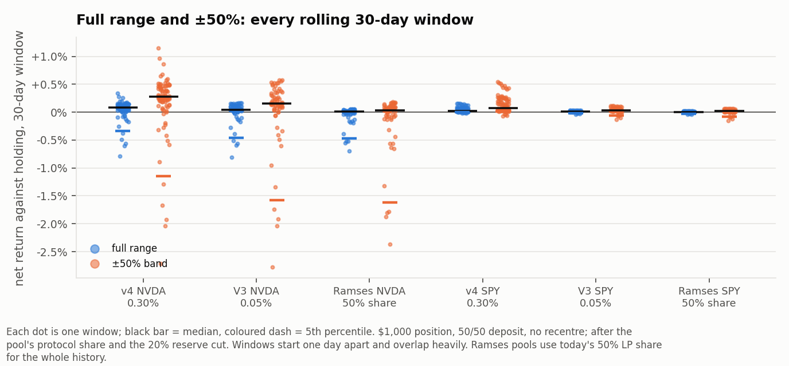

### 11.1 What was modelled

- **Full range:** the adapter's default range (minimum to maximum usable tick). A 50/50 deposit is deployed in full.
- **±50%:** a band from 0.5 to 1.5 times the oracle price at deployment. The vault's range library does not allow it
  today (its widest half-width is 4,800 ticks, −38% to +62%); it is modelled as asked. Nothing is swapped at deployment,
  so a 50/50 deposit puts all its quote and about 63% of its stock in the band and holds the rest of the stock idle
  (80% of capital deployed).
- Neither position recentres: NVDA and SPY stayed inside ±50% throughout. Same ledger as section 5: fees are the LP
  share of each swap's fee, diluted by our own liquidity, less the 20% reserve cut; the benchmark is the 50/50 deposit
  held untouched; both are valued at the oracle.
- **Windows:** every 30-day window starting one day apart (53 to 90 per pool). v4 NVDA runs from 16 July (section 5.1)
  and, for a like-for-like comparison with V3 and Ramses, again from 4 August.
- **Ramses** pools use today's 50% LP share for their whole history, as asked for NVDA; SPY is treated the same way.
- **SPY** has history on Uniswap v4 0.30% (from 14 July), Uniswap V3 0.05% (from 19 August, after its thin first week)
  and Ramses (from 19 August).
- **Fee-to-loss ratio:** measured per unit of liquidity on real swaps at +1 hour, as in section 4, over the same window.
  For a position that stays in range with constant liquidity this is exact, and it is the same for full range and for
  ±50%. It uses the LP fee before the vault's reserve cut.

### 11.2 Fee ÷ loss (+1 hour) over the same windows

| Pool | Whole window | Lowest 30-day window | Median 30-day window | 30-day windows above 1.0 |
| --- | --- | --- | --- | --- |
| Uniswap v4 NVDA/USDG 0.30% (from 16 Jul) | 1.88 | 0.87 | 1.64 | 94% of 88 |
| Uniswap V3 NVDA/USDG 0.05% (from 4 Aug) | 1.19 | 0.69 | 1.18 | 72% of 69 |
| Ramses NVDA/USDG at a 50% fee share (from 4 Aug) | 0.43 | 0.25 | 0.56 | 1% of 69 |
| Uniswap v4 SPY/USDG 0.30% | 5.04 | 1.14 | 7.05 | 100% of 90 |
| Uniswap V3 SPY/USDG 0.05% | 1.60 | 0.56 | 1.61 | 80% of 54 |
| Ramses SPY/USDG at a 50% fee share | 0.92 | 0.31 | 1.12 | 50% of 54 |

As in section 4.5, the +1 hour figure for the two 0.30% pools is generous: valued against prices that have caught up
(section 7), v4 NVDA's fees have been about equal to its loss since August.

### 11.3 Net return against holding per rolling 30-day window ($1,000)

| Pool | Geometry | Capital deployed | Whole window | Windows | Worst | 5th percentile | Median | Best | At or above holding |
| --- | --- | --- | --- | --- | --- | --- | --- | --- | --- |
| Uniswap v4 NVDA 0.30% (16 Jul to 10 Nov) | full range | 99% | +0.44% | 88 | −0.79% | −0.34% | +0.08% | +0.34% | 83% |
| | ±50% | 80% | +1.49% | 88 | −2.72% | −1.15% | +0.27% | +1.14% | 83% |
| Uniswap v4 NVDA 0.30% (4 Aug to 10 Nov) | full range | 99% | +0.23% | 69 | −0.79% | −0.45% | +0.08% | +0.15% | 83% |
| | ±50% | 81% | +0.77% | 69 | −2.72% | −1.52% | +0.26% | +0.52% | 83% |
| Uniswap V3 NVDA 0.05% (4 Aug to 10 Nov) | full range | 100% | +0.18% | 69 | −0.81% | −0.46% | +0.04% | +0.17% | 78% |
| | ±50% | 80% | +0.62% | 69 | −2.77% | −1.58% | +0.15% | +0.57% | 78% |
| Ramses NVDA at a 50% share (4 Aug to 10 Nov) | full range | 100% | −0.09% | 68 | −0.69% | −0.47% | +0.01% | +0.05% | 66% |
| | ±50% | 81% | −0.31% | 68 | −2.36% | −1.62% | +0.03% | +0.18% | 66% |
| Uniswap v4 SPY 0.30% (14 Jul to 10 Nov) | full range | 99% | +0.25% | 90 | −0.02% | 0.00% | +0.02% | +0.16% | 96% |
| | ±50% | 81% | +0.87% | 90 | −0.07% | +0.01% | +0.07% | +0.55% | 96% |
| Uniswap V3 SPY 0.05% (19 Aug to 10 Nov) | full range | 100% | +0.05% | 54 | −0.04% | −0.02% | +0.01% | +0.03% | 91% |
| | ±50% | 81% | +0.18% | 54 | −0.13% | −0.06% | +0.03% | +0.12% | 91% |
| Ramses SPY at a 50% share (19 Aug to 10 Nov) | full range | 100% | +0.03% | 53 | −0.04% | −0.02% | 0.00% | +0.02% | 81% |
| | ±50% | 81% | +0.09% | 53 | −0.15% | −0.08% | +0.02% | +0.07% | 81% |

### 11.4 Loss-protection reserve (% of deposits; a $1,000 depositor held for 30 days)

| Pool | Geometry | Standing size: 95th-percentile shortfall of one window | Largest shortfall seen | Cost per year, paying shortfalls up to that size | Cost per year, paying every shortfall in full | Brought in per year by the 20% fee cut | Fee cut ÷ cost | Holders' fee income per year |
| --- | --- | --- | --- | --- | --- | --- | --- | --- |
| Uniswap v4 NVDA 0.30% (from 16 Jul) | full range | 0.34% | 0.79% | 0.37% | 0.53% | 0.40% | 1.06 | 1.58% |
| | ±50% | 1.15% | 2.72% | 1.27% | 1.81% | 1.35% | 1.06 | 5.39% |
| Uniswap v4 NVDA 0.30% (from 4 Aug) | full range | 0.45% | 0.79% | 0.54% | 0.65% | 0.33% | 0.61 | 1.32% |
| | ±50% | 1.52% | 2.72% | 1.83% | 2.23% | 1.11% | 0.61 | 4.44% |
| Uniswap V3 NVDA 0.05% (from 4 Aug) | full range | 0.46% | 0.81% | 0.56% | 0.67% | 0.28% | 0.50 | 1.13% |
| | ±50% | 1.58% | 2.77% | 1.91% | 2.29% | 0.96% | 0.50 | 3.86% |
| Ramses NVDA at a 50% share (from 4 Aug) | full range | 0.47% | 0.69% | 0.62% | 0.69% | 0.11% | 0.18 | 0.46% |
| | ±50% | 1.62% | 2.36% | 2.13% | 2.37% | 0.38% | 0.18 | 1.54% |
| Uniswap v4 SPY 0.30% | full range | 0.00% | 0.02% | 0.00% | 0.01% | 0.14% | fully covered | 0.57% |
| | ±50% | 0.00% | 0.07% | 0.00% | 0.03% | 0.49% | fully covered | 1.94% |
| Uniswap V3 SPY 0.05% | full range | 0.02% | 0.04% | 0.02% | 0.02% | 0.05% | 2.70 | 0.19% |
| | ±50% | 0.06% | 0.13% | 0.06% | 0.08% | 0.16% | 2.69 | 0.64% |
| Ramses SPY at a 50% share | full range | 0.02% | 0.04% | 0.03% | 0.03% | 0.03% | 1.08 | 0.11% |
| | ±50% | 0.08% | 0.15% | 0.09% | 0.11% | 0.09% | 1.08 | 0.37% |

How the reserve is computed:

- For each window the depositor's shortfall is max(0, holding − position), as a share of the deposit.
- **Standing size** is the 95th-percentile shortfall of one window: with that much per dollar of deposits the reserve
  pays every shortfall in full in 95% of windows.
- **Cost per year** is the average payout per window when each shortfall is paid up to the standing size, times 365/30.
  It is the answer to "what does the promise cost"; the standing size is the answer to "how much must be there".
- **Brought in** is the vault's existing 20% cut of the fees the position earned, on the same basis.

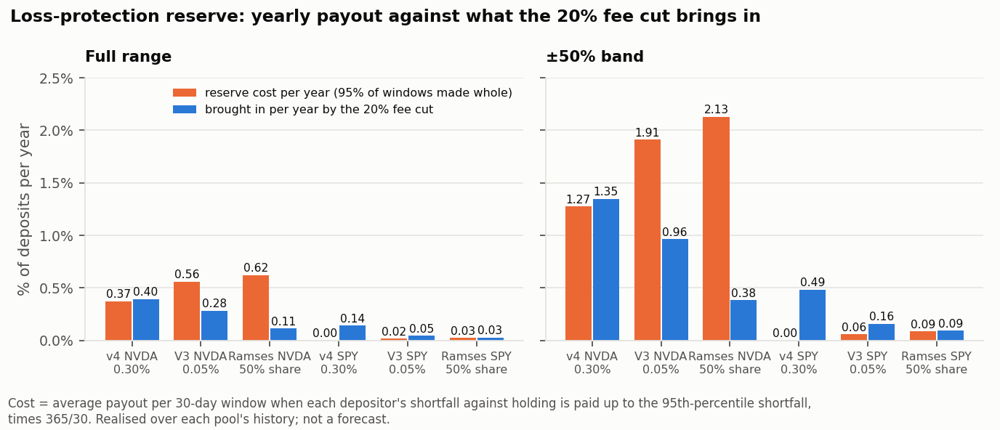

### 11.5 What it says

- **Width does not create an edge.** For a position that stays in range, fees and loss both scale with liquidity. Full
  range and ±50% have the same fee-to-loss ratio, the same share of windows above holding and the same fee cut ÷ cost;
  ±50% is 3.4 times full range in every dollar figure (4.2 times the liquidity per dollar, on 80% of the capital).
- **Full range on NVDA is close to holding, in both directions.** Median window +0.01% to +0.08%, worst −0.7% to −0.8%,
  holders' fee income 0.5% to 1.6% of deposits a year. It is the low-variance end of the surface in section 5.
- **The reserve is small and the fee cut does not reliably fund it.** At full range on NVDA the promise costs 0.4% to
  0.6% of deposits a year. The 20% cut brought in 0.11% (Ramses), 0.28% (V3) and 0.33% to 0.40% (v4). Funding the
  reserve from fees alone would have taken about a 33% cut on v4 since August, 40% on V3 and more than the whole LP fee
  on Ramses, before allowing for the larger shortfalls a bigger cut itself causes.
- **The 5% of windows it does not cover come together.** Every shortfall above the standing size is in the windows
  starting 7 to 11 October, which hold the 14.5% fall of late October, and the largest is 1.5 to 2.3 times the standing
  size. A reserve sized at the 95th
  percentile is exhausted exactly when every depositor's window is under water at once. The largest shortfall seen
  (0.8% of deposits at full range, 2.8% at ±50%) is the more honest standing size.
- **On SPY the question hardly arises:** the largest full-range shortfall in any window is 0.04% of deposits, and the fee
  cut covers the cost on all three pools. The fee income it protects is 0.1% to 0.6% of deposits a year.
- **What 95% means here.** Between 53 and 90 overlapping windows are about three to four independent months containing
  one sharp fall. The percentile describes this history; it is not a tail estimate, and a longer history with a larger
  move would raise every number in the table.
- **Fee income is still falling** (section 2.5), and the keeper's cost is not included: full range needs no recentres,
  but the checkpoint cadence alone ($51 to $208 a year) exceeds the fee income of a $1,000 full-range position on every
  pool here.

### 11.6 Recommendation

| Lever | Decision | Parameters |
| --- | --- | --- |
| Full range as the default for any remaining symmetric LP on Uniswap NVDA or SPY | **Adopt** over ±2,400: it has the smallest worst window of any geometry tested (−0.8% against −3.9% on v4 NVDA) for the same fee-to-loss ratio. It is still not a yield product: about 1% a year to holders. | adapter full range; no recentre policy needed |
| ±50% band | **Reject.** It needs a library change and is full range at 3.4 times the scale; if more exposure is wanted, ±4,800 is already allowed and behaves the same way. | none |
| A loss-protection reserve on full-range NVDA, Uniswap v4 0.30% or V3 0.05% | **Test live at pilot size,** funded as below; do not promise more than 95% of windows. | standing reserve 0.8% of deposits (the largest 30-day shortfall seen); reserve fee cut 35% on v4 and 40% on V3 (20% now); 30-day minimum holding; review after any window whose shortfall exceeds 0.8% |
| The same reserve on Ramses NVDA | **Reject.** At a 50% fee share the cut covers 18% of the cost. | none |
| A loss-protection reserve on full-range SPY | **Adopt if a SPY market is opened:** the current 20% cut covers it on all three pools. | standing reserve 0.05% of deposits; fee cut 20% |

## 12. All levers in one table

| Lever | Decision | Exact parameters |
| --- | --- | --- |
| Symmetric LP on Pharaoh WAVAX/USDC | Reject | none: LPs receive no swap fee |
| Symmetric LP on Ramses NVDA or SPY as a fee product | Reject | none: fee ÷ loss 0.30 and 0.37 since the LP share became 50% |
| Symmetric LP on NVDA, any venue or geometry | Reject | none: no cell survives the latest 30 days |
| Symmetric LP on Uniswap v4 0.30% SPY | Test live at pilot size, once a SPY market exists | ±1,200 / 300, max 4 a day, cooldown 3,600 s, loss bound 10 bp; stop after two consecutive 30-day windows below holding |
| Recentre after a policy change | Adopt | send `recenter` after `RangePolicyUpdated`; alarm when the range in the pool is not the policy's width |
| Tight recentre triggers | Reject | trigger at half the half-width or 600, whichever is smaller |
| Band copy: order type, not yield | Adopt | no fee claim on WAVAX/USDC |
| Band non-finality disclosed | Adopt | stated before placement |
| Band width on WAVAX | Test live at pilot size | 100 ticks (now 200), distances 100 / 300 / 490 |
| Band presets on SPY | Reject shipped presets; test scaled ones at pilot size | 30 / 60 / 100 ticks away, 50 wide |
| Hedged LP as a D order | Reject | none |
| Keeper spacing for rewards | Adopt as built | 120 s; at least 112 s on Pharaoh |
| Settle before admit | Adopt with a guard | settle only 100 s (Ramses) or 112 s (Pharaoh) after the last liquidity change |
| Hourly rebalance on a reward-earning position | Reject | value gate only |
| Session-aware width | Reject | none |
| Blackhole as execution venue, as a home for bands, or as a staked LP product | Reject | none: a fifteenth to a twenty-fifth of Pharaoh's depth; unstaked positions earn nothing |
| Full range as the default for any remaining symmetric LP on Uniswap NVDA or SPY | Adopt | adapter full range |
| ±50% band | Reject | none |
| Loss-protection reserve, full-range NVDA on Uniswap | Test live at pilot size | standing 0.8% of deposits; fee cut 35% (v4) or 40% (V3); 30-day minimum holding |
| Loss-protection reserve, Ramses NVDA | Reject | none |
| Loss-protection reserve, full-range SPY | Adopt if a SPY market is opened | standing 0.05% of deposits; fee cut 20% |
| Naive LVR as the loss estimate | Adopt | σ²/4 × L√P, σ from a fast pool or the outside market |
| LVR × P_trade as a forecast of LP loss | Reject | none |

## 13. Reproducing this report

- `sh scripts/run_all.sh` rebuilds every file in `out/` and `charts/` from `data/` with no network (Python 3.9 or later
  with numpy and matplotlib; about an hour and a half on six cores). **Tested:** run end to end in a fresh clone of the
  branch, it reproduced every number in the 45 result files it can rebuild (`scripts/compare_out.py`); the four it cannot
  need the table named below. `out/logs/` holds the console output of the runs behind this
  report, and `out/tables_q1.md`, `tables_q2.md`, `tables_q3.md` and `tables_q456.md` hold every table in full.
- `scripts/pull/` holds the read-only fetch scripts; `data/*/MANIFEST.json` and `SHA256SUMS` list every table with its
  source, block range, checksum and checks.
- `data/facts/MECHANICS.md` holds the contract and keeper facts with file and line references, and the on-chain
  readbacks used.
- `scripts/vendor/` is the range engine from the earlier Ramses study, unmodified; `scripts/engine_ext.py` adds the
  start split, the outage, the session plan and the delta series by subclassing it.
- One table is not in the repository because of its size (142 MB): `data/robinhood/univ3_nvda_005_swaps.csv.gz`.
  Section 4.9's first row needs it; `scripts/pull/rh_05c_univ3_005.py` rebuilds it.
